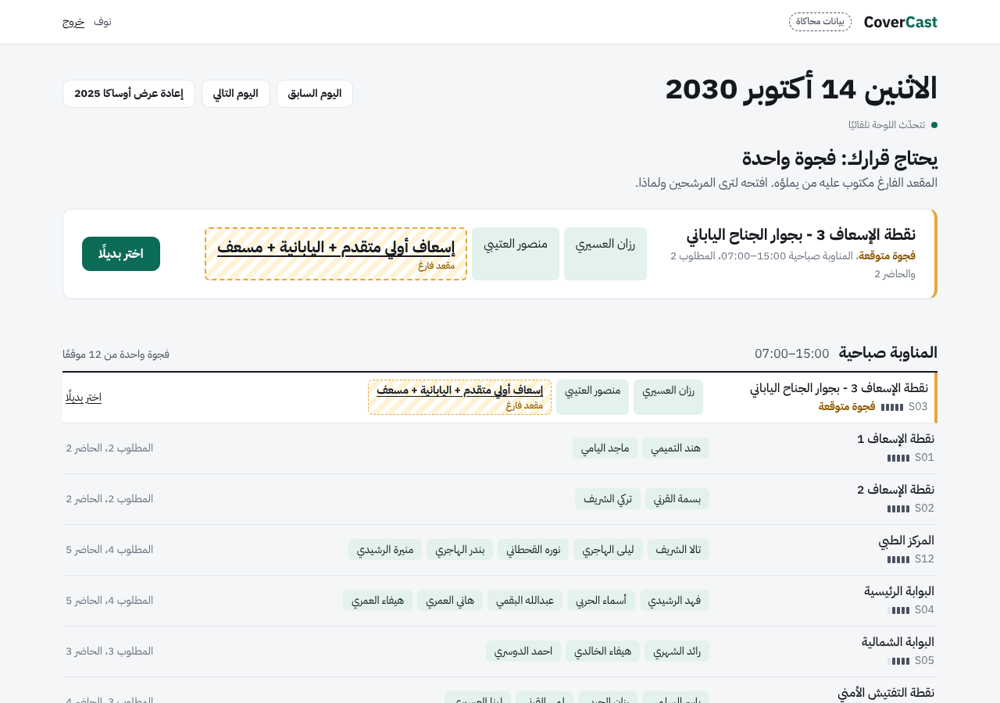
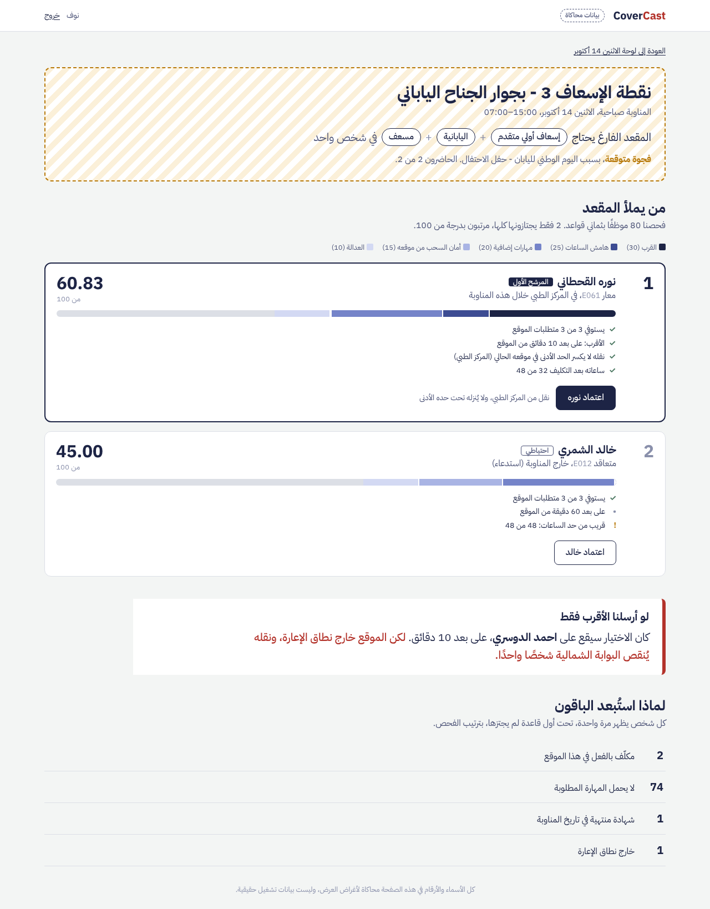
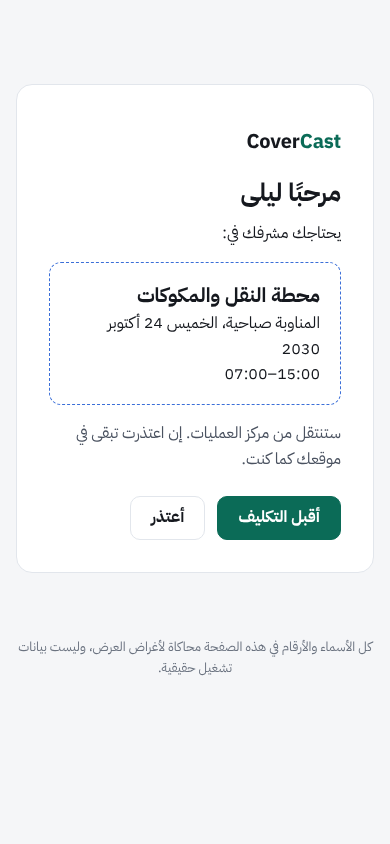
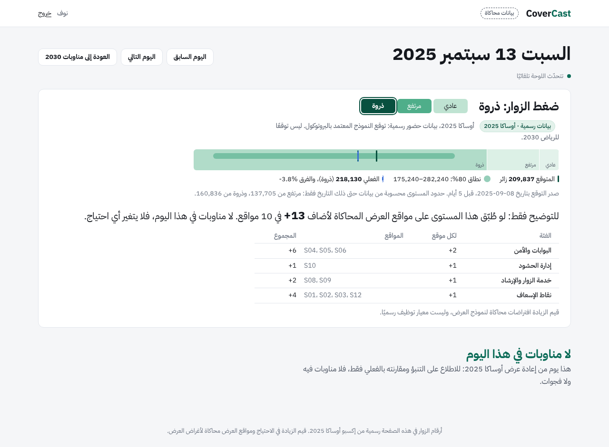
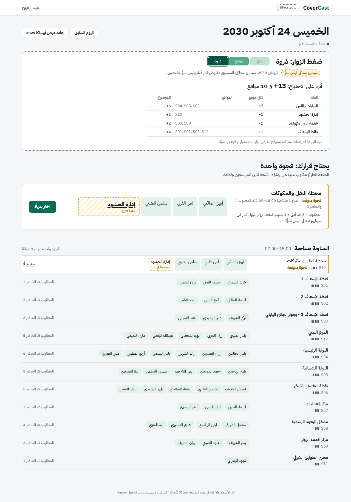

# CoverCast

**يكتشف المقعد الفارغ في المواقع الحرجة لإكسبو 2030 الرياض قبل أن يصبح مشكلة، ويقول من يملؤه ولماذا، ويترك القرار للمشرف.**

> **تنويه عن البيانات:** بيانات الموظفين والمواقع والتكليفات وسيناريو الرياض في المستودع **محاكاة**، وليست بيانات تشغيل رسمية أو معلومات موظفين حقيقيين. أما سلسلة الحضور التاريخية المستخدمة في تجربة التنبؤ فهي من **أوساكا 2025**، ومصدرها موثق بشكل مستقل. التفاصيل في [`data/demo/README.md`](data/demo/README.md) و[`docs/20-data-provenance.md`](docs/20-data-provenance.md).

## ما هو CoverCast؟

**CoverCast** نموذج أولي (MVP) لنظام دعم القرار في تخطيط تغطية المواقع الحرجة بالكوادر المناسبة أثناء الفعاليات الكبرى. صُمم حول سيناريو **إكسبو الرياض 2030**: عندما تتغير احتياجات أحد المواقع بسبب فعالية أو غياب موظف، لا يكفي معرفة *كم شخصًا ينقص الموقع*؛ بل يجب معرفة **أي مهارة تنقصه، ومن يمكن تكليفه دون خلق فجوة في موقع آخر**.

يساعد النظام المشرف على كشف فجوات التغطية، فحص أهلية المرشحين وتفسير أسباب الاستبعاد، ترتيب البدائل، واعتماد التكليف. القرار النهائي **بيد المشرف**، وليس قرارًا آليًا يتخذه نموذج الذكاء الاصطناعي.

## كيف يعمل النظام؟

1. **الحدث والاحتياج:** تُقرأ الفعاليات ومتطلبات الموقع وعدد الموظفين والمهارات اللازمة.
2. **التغطية الحالية:** يُقارن الاحتياج بالمناوبات والتكليفات والغيابات لتحديد الفجوة، بما فيها فجوات المهارات حتى لو اكتمل عدد الأشخاص.
3. **المرشحون:** يفحص المحرك الموظفين وفق قواعد الأهلية، ويوضح أسباب استبعاد غير المؤهلين.
4. **التوصية المفسَّرة:** يرتّب المرشحين المؤهلين بدرجات قابلة للفهم، ويراعي أثر نقل الموظف على موقعه الحالي.
5. **القرار والتأكيد:** يراجع المشرف النتائج ويعتمد، ثم يستطيع الموظف قبول العرض أو الاعتذار من هاتفه عبر رابط موقّع؛ وتُحدَّث التغطية تبعًا للنتيجة.

**دور التنبؤ:** توجد وحدة منفصلة لتقدير الحضور اعتمادًا على سلسلة زمنية تاريخية، ويمكن استيراد ناتجها إلى عرض التغطية. **التنبؤ بالحضور لا يختار الموظف**؛ اختيار البدائل تحكمه قواعد الأهلية والترتيب المذكورة أعلاه.

## أبرز الوظائف

- لوحة لمتابعة المواقع الحرجة والفجوات المتوقعة والمؤكدة.
- اكتشاف نقص المهارات حتى في المواقع المكتملة عدديًا.
- استبعاد غير المؤهلين بأسباب واضحة، وترتيب المؤهلين مع توضيح الدرجة.
- التحقق مجددًا عند الاعتماد ومنع التكليف المزدوج.
- صفحة مناسبة للجوال لقبول عرض التكليف أو الاعتذار عنه.
- بيانات ديمو قابلة لإعادة التحميل، وسيناريو ضغط محاكى للرياض، وتجربة لإعادة عرض بيانات أوساكا التاريخية.

## جولة مصوّرة

**لوحة التغطية:** تلخص وضع المواقع وتظهر الفجوة التي تستدعي قرارًا.



**ترشيح البدائل واستجابة الموظف:** من تفسير أهلية المرشحين حتى قبول العرض أو الاعتذار عنه.

| شاشة المرشحين | صفحة الموظف على الجوال |
|---|---|
|  |  |

**مشاهد إضافية من النظام:**

| توقع الحضور — إعادة عرض أوساكا | سيناريو الرياض المحاكى |
|---|---|
|  |  |

## في دقيقة: قصة G1

صباح الاثنين 14 أكتوبر 2030 يُقام حفل اليوم الوطني الياباني بجوار نقطة الإسعاف 3. في الموقع مسعفان، والعدد مكتمل، لكن **لا أحد منهما يتحدث اليابانية**.

1. **الحدث يحدد أي مهارة نحتاج**، والجدول يحدد من موجود، والمحرك يرى المقعد الناقص: «مسعف + إسعاف أولي متقدم + اليابانية، في شخص واحد».
2. **يفحص الثمانين موظفًا بثماني قواعد**، ويسجّل لكل مستبعد أول قاعدة لم يجتزها: 74 لا يحملون المهارة، واثنان موجودان أصلًا، وريم شهادتها تنتهي قبل الحدث بيوم، واحمد خارج نطاق إعارته.
3. **يرتّب الناجحين بدرجة من 100 بأجزاء ظاهرة:** نوره 60.83 (من المركز الطبي، ونقلها لا يكسر حده الأدنى)، ثم خالد 45.00 (يُستدعى من خارج المناوبة).
4. **ويقول ما كان سيحدث لو أُرسل «الأقرب» فقط:** احمد، على بعد 10 دقائق. لكن الموقع خارج نطاق إعارته، ونقله يُنقص البوابة الشمالية شخصًا.
5. **المشرف يعتمد.** النظام يعيد الفحص لحظة الاعتماد، ويمنع التكليف المزدوج حتى لو ضغط مشرفان في الثانية نفسها. نوره تقبل أو تعتذر من جوالها برابط موقّع، فإن اعتذرت تعود إلى موقعها وتُفتح الفجوة من جديد.

## التنبؤ بالحضور: ماذا اختُبر فعليًا؟

تحتوي وحدة `forecast/` على مقارنة لثلاث طرق للتنبؤ بالحضور على سلسلة تاريخية واحدة لأوساكا 2025، مع اختلاف المعلومات التي يحتاجها كل نموذج:

| النموذج | الفكرة | نوع المدخلات |
|---|---|---|
| **Seasonal Naive** | خط أساس يعتمد على تكرار النمط الأسبوعي | الحضور التاريخي |
| **Calendar Regression** | انحدار يستفيد من العوامل الزمنية والتقويمية | الحضور وخصائص التقويم |
| **Chronos-2** | نموذج سلسلة زمنية مدرّب مسبقًا | الحضور التاريخي |

تُقيّم النماذج على **تواريخ وأهداف موحدة**؛ وتوجد ملفات التقييم والنتائج المحفوظة ضمن `forecast/out/`، مع بروتوكول المقارنة في [`forecast/EVALUATION_PROTOCOL.md`](forecast/EVALUATION_PROTOCOL.md). لا تعني المقارنة أن النماذج الثلاثة تستخدم السمات نفسها؛ بل إنها تتنبأ بالمتغير نفسه وفق فرص تقييم موحدة.

**حدود الاستنتاج:** الدقة المُقاسة تخص بيانات أوساكا التاريخية، ولا تثبت دقة التنبؤ بإكسبو الرياض 2030. في عرض الرياض، مستوى الزوار «ذروة» **افتراض سيناريو** وليس ناتج نموذج تنبؤ مدرّب على بيانات الرياض. التفاصيل والمنهجية والقيود في [`docs/18-forecast.md`](docs/18-forecast.md) و[`docs/20-data-provenance.md`](docs/20-data-provenance.md).

## التشغيل من الصفر

يحتاج Python 3.12 أو أحدث (جُرّب على 3.13، في Linux وفي Windows PowerShell). لا يحتاج إنترنت بعد التثبيت.

```bash
python -m venv .venv
source .venv/bin/activate              # Windows: .venv\Scripts\activate
pip install -r requirements.txt        # Django 5.2 فقط
python manage.py migrate
python manage.py load_demo             # بيانات العرض المحاكاة
python manage.py test                  # 305 اختبارات؛ اختبارات المتصفح الأربعة تُتخطى بلا Playwright
python manage.py create_supervisor nouf --name "نوف"   # كلمة المرور تُسأل مرتين
python manage.py runserver
```

ثم `http://127.0.0.1:8000/`. اسم الدخول `nouf`، وهو غير الاسم الظاهر «نوف».

| للعرض | الأمر أو الرابط |
|---|---|
| يوم G1 (فجوة متوقعة، كهرمانية) | `/board?date=2030-10-14` |
| يوم G2 (فجوة مؤكدة، حمراء) | `/board?date=2030-10-15` |
| إعادة البيانات لحالتها الأولى قبل كل تمرين | `python manage.py load_demo --reset` |
| العرض بصفحات خطأ عربية (`DEBUG=0`) | `docs/15-deployment-guide.md` |
| مسار العرض خطوة بخطوة | `docs/14-demo-scenario.md` |
| اختبار المتصفح (اختياري) | `pip install -r requirements-dev.txt` ثم `python -m playwright install chromium` |
| التحقق من أن بيانات v0.2 مطابقة لسكربت التحويل | `python data/build_v02.py --check` |
| يوم الرياض المحاكى (ضغط الزوار «ذروة») | `python manage.py load_demo --reset --scenario riyadh_peak` ثم `/board?date=2030-10-24` |
| إعادة عرض أوساكا 2025 (بيانات رسمية) | `python manage.py import_forecast forecast/out/export/osaka_replay.json` ثم `/board?date=2025-09-13` |
| كل أوامر التحقق، ومنها التنبؤ | `docs/15-deployment-guide.md` (القسم الأخير) |

## ما يضمنه، وكيف نعرف

| الضمان | الدليل |
|---|---|
| النتائج تطابق حسابًا يدويًا كُتب **قبل** المحرك | `coverage/tests/fixtures/expected_g1.csv` (حساب مرجعي موثّق في المشروع)، ويُقارن صفًا صفًا |
| لا تكليف مزدوج، حتى مع مشرفين في اللحظة نفسها | خيطان حقيقيان على ملف قاعدة بيانات (`test_concurrency.py`) |
| ما رآه المشرف قبل دقائق يُعاد فحصه عند الاعتماد | شهادة صُححت بعد العرض فرُفض الاعتماد بـ`CERT_EXPIRED` |
| لا صفحة ولا بيانات بلا صلاحية | اختبار يمر على **كل** مسار في المشروع آليًا |
| يعمل بلا إنترنت | لا رابط خارجي في القوالب، وصفر طلبات خارجية في متصفح حقيقي |
| الاختبارات تحرس فعلًا | أكثر من 30 تجربة تخريب متعمد التُقطت كلها (`docs/08-testing-strategy.md`) |

## القيود المعروفة

صريحة، ولكل منها سبب في الوثائق:

1. **رابط الموظف لا يُرسل آليًا.** المشرف ينسخه، فلا بريد ولا SMS في هذه النسخة (A-25).
2. **لا حد لمحاولات الدخول الخاطئة.** مقبول لعرض محلي، ويلزم قبل أي نشر حقيقي.
3. **مستوى الزوار في الرياض سيناريو لا تنبؤ.**
   - يوم الرياض محاكى، ومستواه «ذروة» مفروض.
   - قيم الزيادة افتراضات اعتمدها الفريق (A-31).
   - الدقة المقيسة لأوساكا 2025 فقط (`docs/18-forecast.md`).
4. **SQLite لا PostgreSQL.** يكفي للعرض ولمشرفين متزامنين قليلين، والتسلسل مضمون بـ`BEGIN IMMEDIATE`.
5. **الأوزان والسقوف افتراضات موثقة** (`docs/12-assumptions.md`، A-01…A-35)، وليست أرقامًا رسمية.
6. **قوالب أسباب الفريق بصيغة المذكر** («نقله»، «ساعاته»)، لأن البيانات لا تحدد الجنس. نصوص النظام نفسه محايدة (A-28).

## تطوير قادم

- **حماية المهارات النادرة (IMP-01):** من بين المؤهلين يُقدَّم من لا يحمل مهارة نادرة لا يحتاجها الموقع، حتى لا يُستهلك مسعف في مكان لا يحتاجه. يحل محل مكوّن «المهارات الإضافية» (20 نقطة) المعطّل حاليًا.
- إرسال الرابط للموظف بالرسائل.
- حد لمحاولات الدخول، وPostgreSQL للنشر.

## الهيكل

```text
config/        الإعدادات: SQLite بوضع IMMEDIATE، والأسرار من متغيرات البيئة
workforce/     الناس: الموظفون، المهارات، المناطق، قواعد الفئات، الغياب
coverage/      المواقع، المتطلبات، المناوبات، التكليفات
  policy.py    كل رقم يستخدمه المحرك، مع سببه
  codes.py     الرموز الثابتة: الحالات، ورموز الاستبعاد، ورموز الأخطاء
  importer.py  قراءة حزمة البيانات والتحقق منها وتحميلها ذريًا
  services/    المحرك: snapshot وحده يقرأ قاعدة البيانات، والباقي حساب نقي
               demand ← gaps ← eligibility ← ranking (+ baseline للمقارنة)
               وكتابة التكليفات والغياب عبر approval وoffers وabsence فقط
  api/         JSON للشاشات (docs/06)
  views.py     الصفحات العربية: اللوحة، والمرشحون، وصفحة الموظف
  templates/ static/   قوالب RTL، وCSS، وJS صغير، وخط IBM Plex Sans Arabic محليًا (OFL)
  forecast_import.py   استيراد ملف التنبؤ (تشغيل رسمي لأوساكا، أو سيناريو محاكى للرياض)
data/demo/     v0.1 (حزمة رغد مجمّدة) و v0.2 (بعد الإصلاحات) و build_v02.py
               و scenario_riyadh_peak/ (يوم الرياض المحاكى)
forecast/      خط التنبؤ خارج Django: السلسلة الرسمية، والنماذج، والتقييم، والتجميد، والتصدير
tools/         check_docs.py: مسارات الوثائق وأرقامها
docs/          التوثيق، وصور الشاشات في docs/screens/
```

## التوثيق

- **للبدء أو الاستئناف:** `docs/17-resume-here.md`.
- **خريطة كل الوثائق:** `docs/00-project-overview.md`.
- **أهمها:**
  - المحرك بالرسم وسطرًا بسطر: `05`.
  - عقد الـAPI: `06`.
  - تقرير كل مرحلة: `09`.
  - الأخطاء وأسبابها: `11`.
  - الافتراضات: `12`.
  - المفاهيم المستخدمة، ومنها التنبؤ وتعلم الآلة: `16`.
  - التنبؤ بالحضور، من F1 إلى التقييم النهائي والربط: `18`.
  - البحث وتعريف المشكلة: `19`.
  - مصدر كل البيانات: `20`.
  - مساهمات الفريق: `21`.
  - رحلة التطوير: `22`.

**الفريق:** نوف (قائدة الفريق)، ورغد (البيانات والتنبؤ)، ومحمد (البيانات والتنبؤ)، وشهد (UX/UI). بُني المشروع بمساعدة Claude.
