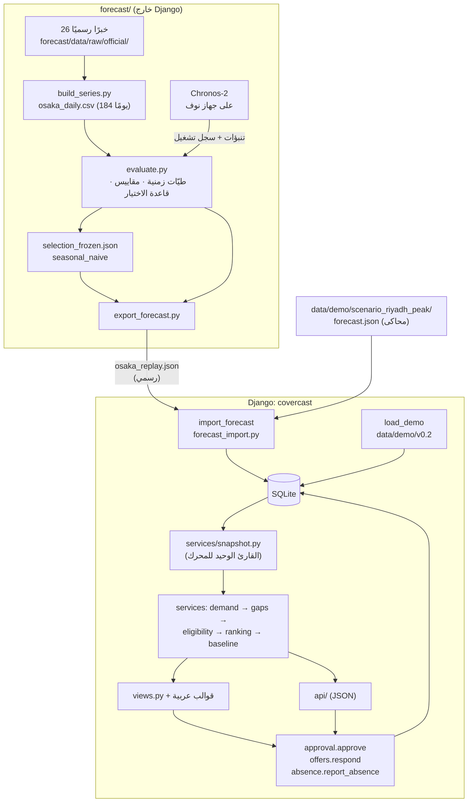
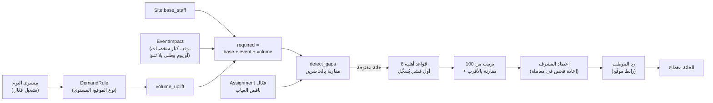
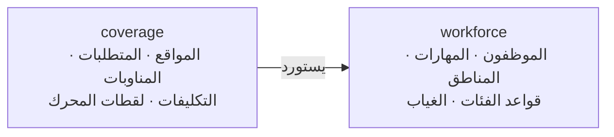

# 02 — المعمارية

المخطط الأول وتوزيع المسؤوليات في `phase-0-audit.md` §5. هنا ما نُفذ فعلًا، محدّثًا حتى P0 (15 أكتوبر 2026).

## النظام كاملًا

جزآن منفصلان، يربطهما **ملف** لا استيراد كود ([ADR 0009](adr/0009-forecast-outside-django.md)):

## تدفق البيانات: من مستوى الزوار إلى خانة مغطاة

## التطبيقان واتجاه الاعتماد

- `coverage` يعرف `workforce`، والعكس **ممنوع** (`test_workforce_never_imports_coverage`).
- لهذا تعيش بيانات المرجع المشتركة (`Zone`، `Skill`) في `workforce`.

## الطبقات داخل `coverage`

| الطبقة | الملف | الحالة | تفعل | لا تفعل |
|---|---|---|---|---|
| الرموز | `codes.py` | منفذ | قيم ثابتة يتشاركها الكل | — |
| السياسة | `policy.py` | منفذ | كل رقم تشغيلي مع سببه | منطق |
| النماذج | `models.py` | منفذ | البيانات والقيود البنيوية | مقارنة أشخاص بمواقع |
| المستورد | `importer.py` | منفذ | قراءة الحزمة والتحقق والتحميل الذري | قواعد المحرك |
| الخدمات | `services/` | منفذ | كل قاعدة تشغيلية؛ الحساب نقي بلا ORM | قراءة `request` |
| الواجهات | `views.py`، `api/` | منفذ | استقبال، تحقق، صلاحية، استدعاء الخدمة | قواعد أعمال |
| استيراد التنبؤ | `forecast_import.py` | منفذ (P0-3) | فحص ملف التنبؤ وكتابته ذريًا | حساب أي تنبؤ |
| الأوامر | `management/commands/` | `load_demo` (مع `--scenario`)، و`import_forecast`، و`create_supervisor`، و`session_report` | تشغيل الخدمات من الطرفية | تكرار منطق |

## لماذا منطق الأعمال في Services لا في Views ولا في Models

- **في View:** القاعدة نفسها ستلزم في الـAPI، وفي صفحة HTML، وفي الاختبار، وفي إعادة الفحص عند الاعتماد. أربع نسخ تنحرف عن بعضها.
- **في Model:** النموذج يعرف صفه فقط. أما «هل يمكن نقل نوره من S12 دون كسر حدها؟» فتحتاج موقعين ومناوبة وكل تكليفاتهما.
- **في Services:** دالة واحدة يستدعيها الجميع. وإذا كانت نقية (لقطة ← نتيجة) تُختبر بلا قاعدة بيانات.

## كيف يتفاعل التنبؤ مع المحرك

باتجاه واحد، وعبر ملف:
- `forecast/` لا يستورد Django، وDjango لا يستورد `forecast/`. الجسر ملف JSON بصيغة `covercast-forecast-v1`.
- `import_forecast` يتحقق من الملف ويكتبه `ForecastRun` مع أيامه، في معاملة واحدة.
- `snapshot.forecast_for` يقرأ مستوى اليوم من التشغيل **الفعّال** فقط. ثم `build_demand` يحوّل المستوى إلى `volume_uplift` عبر `DemandRule`.
- بلا تشغيل فعّال لليوم: `volume_uplift = 0`، ويُحتسب عدد اليوم الوطني إن وُجد (BR-02).
- إعادة عرض أوساكا لا تؤثر في أي خانة، لأن 2025 بلا مناوبات.
- `services/forecast_view.day_forecast` يقرأ الشيء نفسه للوحة و`GET /api/forecast`، ويحسب الأثر من جدول `DemandRule` نفسه، فلا تعرض اللوحة أثرًا لا يطبّقه المحرك.
