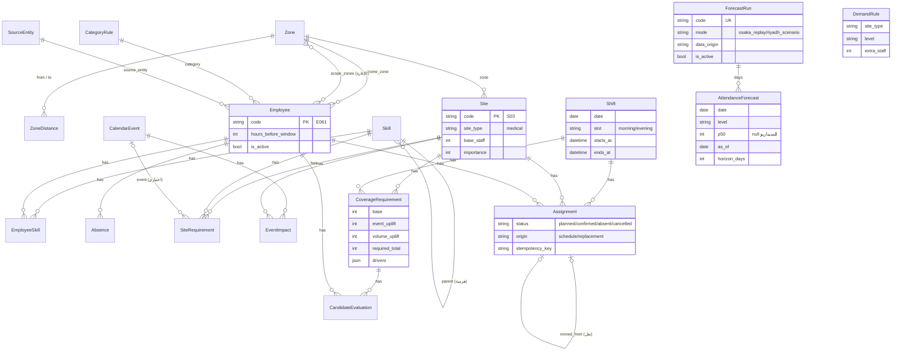

# 03 — تصميم قاعدة البيانات

19 نموذجًا في تطبيقين: الـ18 الأصلية (القرار D4، وسبب كل اختلاف عن تصميم التقرير في `phase-0-audit.md` §7.1)، و`ForecastRun` المضاف في P0-2 (migration `0004`، 15 أكتوبر 2026).

## المخطط (ERD)

يُقرأ السهم: «كثير ← واحد». مثلًا كل `Assignment` يشير إلى `Employee` واحد، والموظف له تكليفات كثيرة. الحقول المعروضة أهمها فقط.

`DemandRule` لا يرتبط بمفتاح أجنبي: يُطابَق بقيمة `Site.site_type` ومستوى اليوم (`services/demand.py`).

**كيف تُقرأ القيود هنا:**
- **قيد قاعدة بيانات** (`UniqueConstraint` / `CheckConstraint`): تفرضه SQLite نفسها، ولا يتجاوزه أي كود.
- **`clean()`:** تحقق في Python. يعمل في لوحة الإدارة والنماذج (forms)، و**لا** يعمل تلقائيًا مع `objects.create()`.
- **`PROTECT`:** يمنعه Django قبل الوصول إلى SQL، ويرمي `ProtectedError` لا `IntegrityError` (انظري `16-learning-notes.md`).

**الأوقات** تُخزن بتوقيت UTC (`USE_TZ = True`) وتُعرض بتوقيت الرياض. مناوبة 07:00 الرياض = 04:00 UTC في قاعدة البيانات.

**كل الأمثلة أدناه صفوف حقيقية من حزمة العرض بعد `load_demo`.**

---

## تطبيق `workforce`

### Zone — المنطقة
- **الغرض:** المناطق A–E. يعيش هنا لا في `coverage` حتى يبقى اتجاه الاعتماد واحدًا.
- **الحقول:** `code` (فريد)، `name`.
- **مثال:** `A · المنطقة A`.

### ZoneDistance — زمن التنقل
- **الغرض:** دقائق المشي بين منطقتين، ومنه مكوّن «القرب» في الترتيب.
- **الحقول:** `from_zone`، `to_zone`، `minutes`.
- **القيود:** فريد على (من، إلى). `PositiveSmallIntegerField` يمنع القيم السالبة.
- **مثال:** A ← C = 15 دقيقة.
- **لو غاب القيد:** صفّان لنفس الزوج بقيمتين مختلفتين، فيصبح الترتيب معتمدًا على أيهما قُرئ أولًا، أي غير حتمي.

### Skill — المهارة
- **الغرض:** كتالوج واحد للشهادات والأدوار واللغات.
- **الحقول:** `code`، `name_ar`، `name_en`، `kind` (certification / role / language)، `parent`.
- **العلاقة:** `parent` ForeignKey إلى نفس الجدول. حامل المهارة يستوفي متطلب أبيها، والعكس غير صحيح.
- **القيود:** CHECK يمنع أن تكون المهارة أبًا لنفسها. و`clean()` يمنع الحلقات الأطول (A ← B ← A)، لأن CHECK لا يستطيع النظر إلى صفوف أخرى.
- **مثال:** `adv_first_aid` (إسعاف أولي متقدم) أبوها `basic_first_aid`.
- **لو غاب القيد:** حلقة في الهرمية تجعل دالة «هل يحمل المهارة؟» تدور إلى ما لا نهاية.

### SourceEntity — الجهة
- **الغرض:** الوزارة أو الشركة أو البرنامج الذي جاء منه الشخص. 13 جهة في العرض.
- **الحقول:** `name` (فريد).

### CategoryRule — قواعد الفئة
- **الغرض:** ما يختلف بين المعار والمتعاقد والمتطوع.
- **الحقول:** `category` (مفتاح أساسي)، `max_weekly_hours`، `min_rest_hours`، `enforce_scope`، `note`.
- **القيود:** `max_weekly_hours > 0`.
- **مثال:** `volunteer`: سقف 30 ساعة، وراحة 11 ساعة، ولا نطاق جغرافي. القيم افتراضات (A-01، A-02).
- **لماذا جدول لا ثوابت في الكود؟** هذه بيانات عن الجهات، وقد تختلف بين جهة وأخرى، بينما أوزان الترتيب قرار تصميم (في `policy.py`).

### Employee — الموظف
- **الغرض:** شخص في المجمّع الموحد.
- **الحقول:**
  - `code`
  - `name`
  - `category` (FK → CategoryRule)
  - `source_entity`
  - `department`
  - `home_zone`
  - `hours_before_window`
  - `scope_zones` (ManyToMany → Zone)
  - `is_active`
  - `data_origin`
- **`hours_before_window`:** الساعات التي لا تأتي من تكليفات مسجلة في CoverCast. الساعات الكلية تُحسب دائمًا = هذا الرقم + 8 × التكليفات الفعّالة في الأسبوع، فلا تتقادم بعد الاعتماد.
- **`scope_zones`:** لماذا ManyToMany لا جدول مستقل؟ لأن جدول نطاق الإعارة في التقرير لا يحمل إلا الموظف والمنطقة، وهذا بالضبط ما يُنشئه Django تلقائيًا.
- **قاعدة «المعار له نطاق، وغيره لا»:** لا يمكن وضعها في `clean()`، لأن صفوف ManyToMany تحتاج موظفًا محفوظًا أولًا. تُفرض في `importer.validate_pack` ولها اختبار (`test_only_loan_employees_have_scope`).
- **مثال:** E061 نوره القحطاني، معارة من وزارة الصحة، منطقتها D، نطاقها C وD وE، و8 ساعات قبل النافذة.

### EmployeeSkill — مهارة الموظف
- **الحقول:** `employee`، `skill`، `expires_on` (فارغ = لا تنتهي).
- **القيود:** فريد على (الموظف، المهارة).
- **الدالة:** `is_valid_on(day)`. تُستدعى دائمًا بتاريخ **المناوبة**.
- **مثال:** E060 ريم، إسعاف متقدم ينتهي 13 أكتوبر 2030، أي يوم قبل الحدث. لذلك هي صالحة «اليوم» ومنتهية يوم المناوبة.
- **لو غاب القيد:** صفّان للشهادة نفسها بتاريخين، فلا نعرف أيهما نصدّق.

### Absence — الغياب
- **الغرض:** إجازة أو مرض أو عدم حضور، **مستقل** عن التكليف (إجازة يوم كامل لا تكليف فيه).
- **الحقول:** `employee`، `kind` (leave / sick / no_show)، `starts_at`، `ends_at`، `reported_at`.
- **القيود:** `ends_at > starts_at`.
- **مثال:** E019، عدم حضور، 15 أكتوبر 2030 من 15:00 إلى 23:00، أُبلغ عنه 14:20 (الفجوة G2).

---

## تطبيق `coverage`

### Site — الموقع الحرج
- **الحقول:** `code`، `name`، `zone`، `site_type`، `base_staff`، `importance` (1–5).
- **القيود:** `base_staff ≥ 1`، و`1 ≤ importance ≤ 5`.
- **مثال:** S03 نقطة الإسعاف 3، بجوار الجناح الياباني: medical، حد أدنى 2، أهمية 5.
- **`importance`:** تدخل في «أمان السحب»، فسحب شخص من موقع أهميته 5 أخطر من سحبه من موقع أهميته 3. القيم افتراض (A-06).

### CalendarEvent — حدث التقويم
- **الحقول:** `code`، `kind`، `title`، `country`، `starts_at`، `ends_at`، `data_origin`.
- **القيود:** `ends_at > starts_at`.
- **`is_forecast_covered`:** صحيحة لأنواع الأحداث التي يراها التنبؤ (يوم وطني، عطلة). مصدرها `policy.FORECAST_COVERED_EVENT_KINDS`.
- **مثال:** الحدث 1: اليوم الوطني لليابان، 14 أكتوبر 2030 من 09:00 إلى 14:00.

### SiteRequirement — متطلب مهارة
- **الحقول:** `site`، `skill`، `min_count`، `event` (اختياري)، `bundle`، `note`.
- **المعنى:**
  - بلا حدث: أساسي دائم.
  - بحدث وبلا bundle: الحد الأدنى **الكلي** أثناء الحدث (يؤخذ الأكبر بينه وبين الأساسي، ولا يُجمعان).
  - بحدث وbundle: `min_count` شخصًا يحمل كل مهارات الـbundle معًا.
- **القيود:**
  - `min_count ≥ 1`.
  - **قيدان فريدان مشروطان**: (الموقع، المهارة) للأسطر الأساسية، و(الموقع، المهارة، الحدث) لأسطر الأحداث.
  - **لماذا اثنان؟** في SQL كل NULL يختلف عن أي NULL آخر. قيد واحد على (الموقع، المهارة، الحدث) كان سيقبل سطرين أساسيين متطابقين. الاختبار `test_duplicate_base_row_rejected` يثبت ذلك.
- **مثال:** S03 + الحدث 1 + `B1` = ثلاثة أسطر: paramedic وadv_first_aid وja، كل منها min_count = 1. المعنى: مسعف واحد يتحدث اليابانية.

### EventImpact — أثر الحدث على العدد
- **الحقول:** `event`، `site`، `extra_staff`.
- **القيود:** فريد على (الحدث، الموقع).
- **`clean()`:** يرفض `extra_staff > 0` لحدث من نوع يراه التنبؤ. **هذا حارس منع العدّ المزدوج** (BR-02).
- **في العرض:** لا صفوف (حزمة رغد لا تضيف عددًا بالأحداث، بل مهارات فقط).

### Shift — المناوبة
- **الحقول:** `date`، `slot` (morning / evening)، `starts_at`، `ends_at`.
- **القيود:** فريد على (التاريخ، الفترة)، و`ends_at > starts_at`.
- **لماذا فترات ثابتة؟** لأن «تداخل تكليفين» يصبح «نفس المناوبة»، وهذا يُفرض بقيد فريد بسيط بدل مقارنة أوقات معقدة (A7 في التقرير).

### Assignment — التكليف
- **الحقول:**
  - `employee`، `site`، `shift`
  - `status`: planned / confirmed / absent / cancelled
  - `origin`: schedule / replacement
  - `approved_by`، `approved_at`، `responded_at`
  - `idempotency_key`، `created_at`
  - `moved_from`، `moved_from_status` (المرحلة 6، ADR 0008): التكليف الذي نُقل منه الموظف، وحالته قبل النقل
- **القيود:**
  1. **فريد على (الموظف، المناوبة) حين الحالة فعّالة.** الضمان الأساسي ضد التكليف المزدوج. التكليف الملغى أو الغائب لا يمنع تكليفًا جديدًا (له اختبار).
  2. **فريد على `idempotency_key` حين لا يكون فارغًا.** الضغطة الثانية بالمفتاح نفسه تجد الصف بدل إنشاء آخر.
  3. **CHECK:** التكليف البديل يجب أن يحمل `approved_by` و`approved_at`. هذا يجعل «لا تكليف بلا إنسان» قاعدة في قاعدة البيانات نفسها، لا في الكود فقط.
  4. **CHECK:** `moved_from` لا يوجد إلا في تكليف بديل، ومعه حالة سابقة نشطة (planned أو confirmed).
- **الحذف:** `PROTECT` على الموظف والموقع والمناوبة، لأن الحذف المتسلسل كان سيمحو سجل التدقيق بصمت.
- **مثال:** S03 صباح 14 أكتوبر: E006 وE018، كلاهما confirmed من الجدول.

### CoverageRequirement — لقطة الاحتياج
- **الحقول:** `site`، `shift`، `base`، `event_uplift`، `volume_uplift`، `required_total`، `drivers` (JSON)، `computed_at`.
- **القيود:**
  - فريد على (الموقع، المناوبة)، أي لقطة واحدة لكل خانة.
  - CHECK: `required_total = base + event_uplift + volume_uplift`.
- **الفجوة لا تُخزّن هنا:** تُحسب من التكليفات الحية، فلا تختلف أبدًا عن الجدول.
- **تُملأ في المرحلة 4.**

### CandidateEvaluation — سجل التقييم
- **الحقول:**
  - `requirement`، `employee`
  - `run_id`: يجمع صفوف تشغيل واحد
  - `slot`، `eligible`، `failed_rule`، `failed_detail`
  - `score`، `score_parts`، `rank`، `tag`، `evaluated_at`
- **القيود:**
  - فريد على (التشغيل، الخانة، الموظف).
  - CHECK: المؤهل بلا سبب، والمستبعد بسبب واحد بالضبط.
  - CHECK: الترتيب للمؤهلين فقط.
- **لو غاب القيد:** استبعاد بلا سبب، وهذا عكس فكرة المنتج كلها.
- **تُملأ في المرحلة 5.**

### ForecastRun — تشغيل تنبؤ (P0-2)
- **الغرض:** ملف تنبؤ واحد مستورد، بمصدره. المحرك يقرأ أيام التشغيلات **الفعّالة** فقط.
- **الحقول:** `code` (فريد)، `mode` (`osaka_replay` أو `riyadh_scenario`)، `model_name`، `data_origin`، `level_method`، `freeze_sha256`، `source_sha256` (بصمة الملف، للتكرار الآمن)، `note`، `is_active`.
- **القيود:**
  - فريد مشروط: تشغيل فعّال واحد لكل وضع.
  - CHECK: `osaka_replay` رسمي دائمًا، و`riyadh_scenario` محاكى دائمًا.
- **لو غاب القيد:** قد يقرأ المحرك تنبؤين لليوم نفسه، أو يُعرض سيناريو محاكى بوسم «رسمي».
- **مثال بعد الاستيراد:** `osaka-replay-seasonal_naive-20d80998` (126 يومًا، رسمي)، و`riyadh-scenario-peak-2030-10-24` (يوم واحد، محاكى).

### AttendanceForecast — يوم من تشغيل
- **الحقول:** `run`، `date`، `level`، `p10`/`p50`/`p90` و`actual` (فارغة في السيناريو)، `as_of`، `horizon_days`، `threshold_high`، `threshold_peak`، `model_version`، `trained_on`، `data_origin`.
- **القيود:**
  - فريد على (التشغيل، التاريخ). استبدل في `0004` القيد القديم (التاريخ، نسخة النموذج).
  - CHECK: `p10 ≤ p50 ≤ p90`.
  - CHECK: `as_of < date` (لا تنبؤ بيوم رآه النموذج).
- **ما يفرضه الاستيراد لا قاعدة البيانات:** كل يوم في إعادة العرض يحمل الأرقام كلها، وأي يوم في السيناريو لا يحمل أي رقم زوار. انظري `04-business-rules.md` BR-27.
- **مثال:** 13 سبتمبر 2025: `p50 = 209,837`، و`actual = 218,130`، و`as_of = 2025-09-08`، والأفق 5، والمستوى `peak`.

### DemandRule — قاعدة الاحتياج
- **الحقول:** `site_type`، `level`، `extra_staff`، `source_note`.
- **القيود:** فريد على (نوع الموقع، المستوى).
- **القيم:** 18 صفًا (6 أنواع × 3 مستويات) تُحمّل مع سيناريو الرياض (`data/demo/scenario_riyadh_peak/demand_rule.csv`). **افتراضات محاكاة اعتمدتها نوف، لا معيار توظيف رسمي.**
- **بلا صفوف:** لا يضيف أي مستوى أفرادًا، وتقول اللوحة ذلك.
