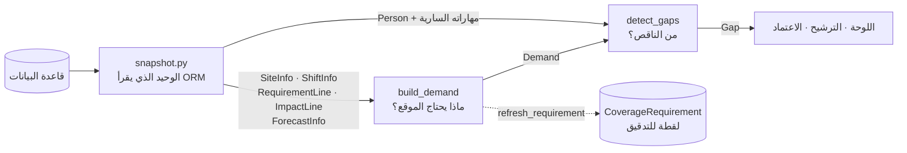
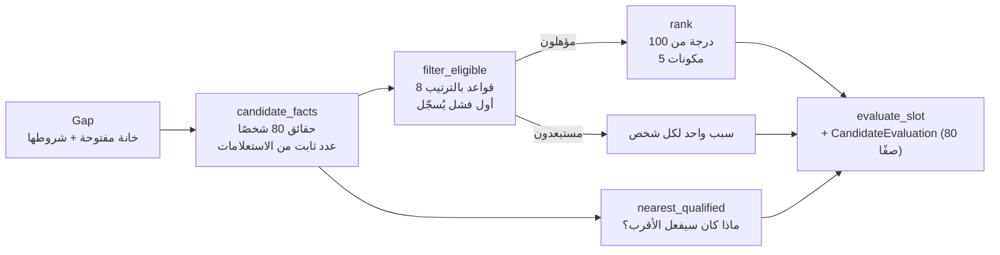

# 05 — محرك التغطية

**الحالة:**
- منفذ: `build_demand` و`detect_gaps` (المرحلة 4)، و`filter_eligible` و`rank` و`nearest_qualified` و`evaluate_slot` (المرحلة 5).
- منفذ أيضًا: `approve` و`respond` و`report_absence` (المرحلة 6)، و`day_board` (المرحلة 8).

## الصورة الكاملة أولًا



**تشبيه:** `snapshot` كاتب يجمع الأوراق من الأرشيف. و`build_demand` و`detect_gaps` محاسبان لا يدخلان الأرشيف أبدًا، بل يحسبان من الأوراق التي أمامهما فقط. لهذا يمكن اختبار المحاسبين بأوراق نكتبها بأيدينا (23 اختبارًا بلا قاعدة بيانات)، ولهذا لا يتغير حسابهما بتغير طريقة التخزين.

## الملفات

| الملف | يقرأ قاعدة البيانات؟ | المسؤولية |
|---|---|---|
| `services/types.py` | لا | أشكال البيانات (dataclasses مجمّدة) |
| `services/skills.py` | لا | `effective_skills`: مهارات الشخص السارية في يوم معيّن، مع الهرمية |
| `services/demand.py` | لا | `build_demand` |
| `services/gaps.py` | لا | `detect_gaps` |
| `services/snapshot.py` | **نعم، وحده** | يحوّل صفوف ORM إلى الأشكال أعلاه |
| `services/requirements.py` | عبر snapshot | يربط الكل: `gap_for` و`refresh_requirement` و`window_gaps` |
| `services/eligibility.py` | لا | القواعد الثماني: `evaluate`، و`filter_eligible` |
| `services/ranking.py` | لا | الدرجة من 100، والترتيب، والوسوم، والأسباب |
| `services/baseline.py` | لا | `nearest_qualified`: ما كان سيفعله «الأقرب» |
| `services/reasons.py` | لا | قوالب الأسباب وصياغة الأعداد العربية |
| `services/evaluation.py` | عبر snapshot | `evaluate_slot`: كل ما سبق لخانة واحدة، مع صفوف التدقيق |
| `services/approval.py` | **يكتب** | `approve` (المرحلة 6) |
| `services/offers.py` | **يكتب** | رد الموظف برابط موقّع |
| `services/absence.py` | **يكتب** | `report_absence` |
| `services/board.py` | عبر snapshot | `day_board`: كل الخانات ليوم واحد |
| `services/errors.py` | لا | `CoverCastError` ورموزه |

---

## `effective_skills(held, parents, on_date)`

- **الغرض:** ما المهارات التي **يملكها فعلًا** الشخص في يوم المناوبة؟
- **المدخلات:**
  - `held`: أزواج (رمز المهارة، تاريخ الانتهاء أو None).
  - `parents`: خريطة المهارة ← أبيها.
  - `on_date`: تاريخ المناوبة.
- **المخرج:** `frozenset` من الرموز.
- **القواعد:**
  1. شهادة انتهت قبل `on_date` لا تعطي شيئًا، **ولا حتى أباها**: من انتهت بطاقة إسعافه المتقدم لا يحتفظ بالأساسي من خلالها.
  2. يوم الانتهاء نفسه ما زال صالحًا (`expires_on >= on_date`).
  3. الهرمية تصعد ولا تنزل: المتقدم يعطي الأساسي، والأساسي لا يعطي المتقدم.
- **مثال:** ريم: `("adv_first_aid", 2030-10-13)`، ويوم المناوبة 2030-10-14 ← لا إسعاف متقدم ولا أساسي.
- **الاختبارات:** `EffectiveSkillsTests` (4).

## `build_demand(site, shift, lines, impacts, forecast, demand_rules)`

- **الغرض:** ماذا يحتاج موقع واحد في مناوبة واحدة، ولماذا.
- **المدخلات:**
  - `lines`: كل `SiteRequirement` للموقع (الأساسية وأسطر الأحداث).
  - `impacts`: `EventImpact`.
  - `forecast`: اختياري.
  - `demand_rules`: (نوع الموقع، المستوى) ← عدد.
- **المخرج:** `Demand`، وفيه:
  - `base`، `event_uplift`، `volume_uplift`، `required_total`
  - `skill_needs`: احتياجات المهارات.
  - `drivers`: أسباب مكتوبة.
- **الخوارزمية:**
  1. سبب أول دائمًا: «الحد الأدنى الدائم للموقع».
  2. نُبقي أسطر المتطلبات الأساسية، وأسطر الأحداث **المتقاطعة مع المناوبة** فقط (`start < shift.end` و`end > shift.start`).
  3. **العدد من الأحداث:** لكل `EventImpact` متقاطع: إن كان الحدث من نوع يراه التنبؤ (`national_day`، `holiday`) يُهمل عدده، ويُضاف سبب من نوع `ignored` يشرح ذلك. وإلا يُضاف إلى `event_uplift`.
  4. **مهارات بلا bundle:** لكل مهارة، **الأكبر** بين الأساسي وأي حدث، لا المجموع. ويُحفظ `base_count` ليُعرف لاحقًا أي جزء من النقص أساسي.
  5. **مهارات bundle:** كل مجموعة (حدث، bundle) احتياج واحد: `count` أشخاص يحمل **كل** واحد منهم كل المهارات.
  6. **الحضور:** إن وُجد تنبؤ ووُجدت قاعدة لنوع الموقع ومستواه، تُضاف `volume_uplift`. وإلا صفر.
  7. ترتيب ثابت للاحتياجات (الأساسية أولًا)، فالمدخلات نفسها بأي ترتيب تعطي النتيجة نفسها.
- **حالات حدّية مختبرة:**
  - حدث خارج المناوبة.
  - حدث يرفع العدد ولا يجمعه (S04: 1 ← 2، لا 3).
  - يوم وطني بعدد مخزّن.
  - تنبؤ بلا قاعدة مطابقة.
  - ترتيب مدخلات مختلف.
- **الاختبارات:** `BuildDemandTests` (10)، `test_national_day_headcount_is_ignored_even_if_stored`.

## `detect_gaps(demand, present)`

- **الغرض:** من الناقص؟
- **المدخلات:** `Demand`، والحاضرون فعلًا. الحاضر = تكليف فعّال **وليس** عليه سجل غياب يتقاطع مع المناوبة.
- **المخرج:** `Gap`، وفيه:
  - `present`، `headcount_gap`
  - `open_slots`: كل خانة بمهاراتها الشرطية `must_have` ومصدرها.
  - `nature`: `None` إن كان مغطى، أو `confirmed`، أو `anticipated`.
- **الخوارزمية:**
  1. `headcount_gap = max(0, required_total − الحاضرين)`.
  2. لكل احتياج مهارة: `covered` = عدد الحاضرين الذين يحملون **كل** مهاراته، و`shortfall = count − covered`. من هذا النقص، ما يقع تحت `base_count` خانات **أساسية**، والباقي خانات **حدث**.
  3. **خانات عامة** = `headcount_gap − عدد خانات المهارة` (إن كان موجبًا). لماذا الطرح؟ لأن الشخص الذي يسد نقص مهارة يسد أيضًا نقص العدد، فلا نطلب شخصين حيث يكفي واحد.
  4. **النوع:**
     - `confirmed` إن وُجدت خانة أساسية، أو كان الحاضرون أقل من الحد الأساسي.
     - `anticipated` إن كان النقص في الإضافات فقط.
- **الخانة العامة تشترط مهارات الموقع الأساسية** (`policy.GENERIC_SLOT_REQUIRES_BASE_SKILLS = True`): انظري «قرار A-15» أدناه.
- **الاختبارات:** `DetectGapsTests` (9)، و`DemoGapsTests` (9).

---

## مثال G1 سطرًا بسطر (بيانات حقيقية)

**S03، صباح الإثنين 14 أكتوبر 2030 (07:00–15:00).**

1. `snapshot.requirement_lines(S03)` يعطي خمسة أسطر:

   ```text
   adv_first_aid ×1 (أساسي)
   paramedic ×1 (أساسي)
   paramedic ×1 · adv_first_aid ×1 · ja ×1  (الحدث 1، bundle B1)
   ```

2. الحدث 1 (09:00–14:00) يتقاطع مع 07:00–15:00، فتبقى الأسطر الخمسة.
3. `impacts` فارغة، فقيمة `event_uplift` = 0. ولا تنبؤ، فقيمة `volume_uplift` = 0. إذن `required_total` = 2.
4. احتياجات المهارة:
   - {adv_first_aid} ×1، أساسي.
   - {paramedic} ×1، أساسي.
   - {paramedic، adv_first_aid، ja} ×1 من الحدث 1، `base_count` = 0.
5. `present_people` يعطي:
   - E006: {ar، en، fr، security_guard، security_license}
   - E018: {adv_first_aid، basic_first_aid، ar، en، paramedic}

   ملاحظة: الأساسي ظهر عند E018 من الهرمية.
6. `headcount_gap = 2 − 2 = 0`.
7. {adv_first_aid}: يغطيه E018، فلا نقص. وكذلك {paramedic}.
8. bundle الحدث: لا أحد يحمل الثلاث، فالنقص 1، كله من الحدث. النتيجة: **خانة واحدة**، شرطها الـbundle، ومصدرها `event:1`.
9. لا خانة أساسية، والحاضرون (2) ليسوا أقل من الأساس (2). إذن النوع **`anticipated`**.

**G2** (S10، مساء 15 أكتوبر): E019 تكليفه `confirmed`، لكن عليه سجل `no_show` 15:00–23:00، فلا يُعد حاضرًا. الحاضران: E003 وE046، والمطلوب 3، فقيمة `headcount_gap` = 1. مهارة crowd_control يحملها E046، فلا خانة مهارة. النتيجة: خانة عامة واحدة، والنوع **`confirmed`** لأن الحاضرين أقل من الأساس.

**على النافذة كلها** (12 موقعًا × 6 مناوبات = 72): هاتان الفجوتان **فقط**، وتطابقان `gap_definitions.csv` الذي كُتب قبل المحرك.

## قرار A-15: الخانة العامة تشترط مهارة الموقع الأساسية

**اعتمدته نوف في 13 أكتوبر 2026.**

**السؤال:** حين يكون النقص في العدد فقط، وشرط المهارة الأساسية متحقق بالحاضرين، هل يجب أن يحمل البديل مهارة الموقع؟

**القرار: نعم.** البديل يجب أن يستطيع أداء عمل المكان، لا أن يملأ كرسيًا فقط.

**لماذا تراجعنا عن «لا»** (كانت تنفيذ المرحلة 4):
- مع «لا» رشّح النظام لمحطة النقل S10 **أروى E022، مسعفة من الهلال الأحمر**، لأن درجتها الأعلى. النظام لم ينظر إلى مهارتها أصلًا.
- ملف رغد `gap_definitions.csv` يحدد لـG2 مهارة `crowd_control`، فالسيناريو يتوقع بديلًا في إدارة الحشود.
- حجة «لا» كانت تجنّب تطبيق القاعدة مرتين، لكنها تتجاهل أن من يملأ مكانًا يجب أن يجيد عمله.

**الأثر على G2:**

| | «لا» (قبل) | «نعم» (الآن) |
|---|---|---|
| شرط الخانة | لا شيء | crowd_control |
| المؤهلون | 12 | 2 |
| المرشحة | أروى E022، مسعفة (61.67) | غادة E058، نقل وحشود (50.00) |
| خط الأساس | E069، يُفرغ S11 | E009، خارج نطاقه ويكسر S09 |

**الثمن:** خيارات أقل. وإن لم يوجد مؤهل، تظهر الفجوة بلا مرشح مع سبب كل استبعاد، وهذا أصدق من ترشيح شخص لا يعرف العمل.

**للرجوع:** `GENERIC_SLOT_REQUIRES_BASE_SKILLS = False` في `policy.py`. السلوكان مختبران (`test_generic_slot_is_open_to_anyone_if_policy_is_switched_off`).

**تحسين مؤجل مرتبط (اقتراح نوف):** حماية المهارات النادرة في الترتيب. مسجل في `docs/12-assumptions.md` تحت «تحسينات مقترحة» (IMP-01).

## الأداء (مقاس، لا مُقدّر)

`window_gaps()` على 72 خانة: **436 استعلامًا، و0.25 ثانية** على قاعدة بيانات العرض، أي نحو 6 استعلامات لكل خانة. يكفي للوحة يوم واحد (24 خانة). قررت المرحلة 9 عدم التجميع أكثر (اللوحة 0.11 ثانية)، ويحرس العدد اختبار (`test_whole_window_query_count_is_bounded`، والحد 576).


---

# المرحلة 5: من يملأ الخانة؟



**تشبيه:** لجنة توظيف بمرحلتين. **الفرز** (eligibility) يقرأ كل ملف بالترتيب نفسه، ويتوقف عند أول شرط لم يتحقق ويكتبه. و**المفاضلة** (ranking) تعطي المرشحين المتبقين درجات معلنة المعايير. أما **خط الأساس** فهو ما كان سيفعله مشرف مستعجل يتصل بأقرب شخص يحمل الشهادة.

## `filter_eligible(people, ctx)` و`evaluate(facts, ctx)`

يُفحص كل شخص بالترتيب، و**أول** فشل يُسجّل:

| # | الرمز | السؤال | ملاحظة |
|---|---|---|---|
| 1 | `ABSENT` | هل عليه غياب يتقاطع مع المناوبة؟ | **قبل** «مكلّف هنا»: E019 في G2 تكليفه ما زال `confirmed` لكنه لم يحضر |
| 2 | `ALREADY_ASSIGNED` | هل هو في هذا الموقع وهذه المناوبة أصلًا؟ | |
| 3 | `MISSING_SKILL` | هل **يحمل** المهارات الشرطية أصلًا (بغض النظر عن الصلاحية)؟ | الهرمية تُطبق |
| 4 | `CERT_EXPIRED` | هل هي **سارية في تاريخ المناوبة**؟ | من لم يملكها يُقال له «ناقصة»، ومن انتهت يُقال له «منتهية» |
| 5 | `SCOPE_OUT` | هل منطقة الموقع ضمن نطاق إعارته (إن كانت فئته تفرض ذلك)؟ | |
| 6 | `HOURS_CAP` | هل تتجاوز ساعاته الأسبوعية السقف بعد التكليف؟ | انظري «الساعات» أدناه |
| 7 | `REST_GAP` | هل الراحة بين هذه المناوبة وأي مناوبة أخرى له أقل من المطلوب؟ | 11 ساعة بالضبط مقبولة |
| 8 | `BREAKS_MINIMUM` | لو غادر موقعه الحالي، هل تُفتح فيه خانة جديدة؟ | يُحسب بـ`detect_gaps` نفسها: عددًا ومهارةً |

**الساعات** (`hours_after`): الساعات قبل النافذة + 8 × (مناوباته الفعّالة هذا الأسبوع، **عدا** المناوبة المستهدفة) + 8.
- الـ8 الأخيرة تُضاف دائمًا. للقادم من خارج الدوام هي مناوبة جديدة، وللمنقول من موقع آخر في المناوبة نفسها هي المناوبة التي كان سيعملها أصلًا.
- الأسبوع من الأحد إلى السبت.
- أخطأتُ في هذا أولًا (E-06)، والتوقعات اليدوية كشفت الخطأ.

**زمن الوصول:** من منطقة موقعه الحالي في المناوبة نفسها. فإن لم يكن في مناوبة، فزمن استدعاء ثابت: 60 دقيقة (A-05).

## `rank(evaluations)`: الدرجة من 100

| المكوّن | الوزن | الحساب | نوره | خالد |
|---|---|---|---|---|
| القرب | 30 | `30 × (25 − الدقائق) / 20`، بين 0 و30 | 10 د ← **22.50** | استدعاء 60 د ← **0.00** |
| هامش الساعات | 25 | `25 × (السقف − الساعات بعد التكليف) / السقف` | (48−32)/48 ← **8.33** | (48−48) ← **0.00** |
| مهارات إضافية | 20 | نسبة مهارات «الميزة» (لا توجد في البيانات ← 20 للجميع) | **20.00** | **20.00** |
| أمان السحب | 15 | 15 إن لم يكن يعمل في مكان آخر، وإلا `15 × (5 − أهمية موقعه) / 4` | تغادر S12 (أهمية 5) ← **0.00** | غير مكلّف ← **15.00** |
| العدالة | 10 | `10 − 5 × مناوباته البديلة هذا الأسبوع` | **10.00** | **10.00** |
| **المجموع** | 100 | مجموع الأجزاء **بعد** تقريب كل جزء إلى 0.01 | **60.83** | **45.00** |

- **لماذا يُجمع المقرَّب؟** حتى يساوي الشريط على الشاشة الرقم بجانبه دائمًا.
- **فك التعادل:** الدرجة، ثم الأقرب، ثم الأقل ساعات، ثم رمز الموظف. لا عشوائية (مختبر بـ100 خلط).
- **الوسم:** الأول `recommended`، والثاني `backup`.
- **الأسباب:** `REQ_MET`، ثم `NEAR` للأقرب فقط أو `TRAVEL` (محايد) للبقية (E-13)، ثم `KEEPS_MIN_AT_SITE`، ثم `HOURS_OK` أو `NEAR_HOURS_CAP`. نصوصها من قوالب الفريق (`services/reasons.py`)، واختبار يمنع اختلافها عن `reason_templates.csv`.

**الدرجة أداة ترتيب شفافة، وليست احتمال أن يكون الاختيار صحيحًا.**

## `nearest_qualified(people, ctx)`: خط الأساس

- **ما يفعله مشرف اليوم:** أقرب شخص يحمل المهارات بشهادة سارية، ليس غائبًا وليس في الموقع أصلًا. يتجاهل النطاق والساعات والراحة والموقع الذي سيغادره. عند تساوي المسافة يُختار الأصغر رمزًا (A-17).
- **ثم نسأل قواعد CoverCast نفسها** عن هذا الاختيار: أول قاعدة يخالفها (`violates`)، والموقع الذي سيتركه ناقصًا (`breaks_site`، `donor_short_by`).

## النتائج على بيانات العرض

### G1 — S03 صباح الإثنين: «مسعف يتحدث اليابانية»

مطابقة **كاملة** للتوقعات المكتوبة يدويًا **قبل** المحرك (`coverage/tests/fixtures/expected_g1.csv`، commit `5a50a92`):

| | العدد | من |
|---|---|---|
| مؤهلون | 2 | نوره 60.83 (مرشحة)، خالد 45.00 (احتياطي) |
| `MISSING_SKILL` | 74 | كل من لا يتحدث اليابانية |
| `ALREADY_ASSIGNED` | 2 | E006، E018 |
| `CERT_EXPIRED` | 1 | ريم: تنتهي 2030-10-13، والمناوبة 14 |
| `SCOPE_OUT` | 1 | احمد: نطاقه A وB، والموقع في C |

**الأقرب كان سيختار احمد** (10 دقائق، تعادل مع نوره، والرمز أصغر). وهو خارج نطاق إعارته، **ويترك البوابة الشمالية S05 ناقصة شخصًا** (3 من 3 ← 2).

### G2 — S10 مساء الثلاثاء: خانة عامة شرطها إدارة الحشود (A-15)

| النتيجة | العدد | من |
|---|---|---|
| مؤهلون | 2 | غادة E058 50.00 (مرشحة)، شروق E013 45.00 (احتياطي، تصل سقفها بالضبط: 48 من 48) |
| `MISSING_SKILL` | 58 | لا يحملون إدارة الحشود |
| `ABSENT` | 3 | منهم E019 صاحبة الغياب |
| `ALREADY_ASSIGNED` | 2 | E003، E046 |
| `CERT_EXPIRED` | 1 | E033: انتهت 10 سبتمبر 2030 |
| `BREAKS_MINIMUM` | 6 | |
| `HOURS_CAP` | 3 | |
| `REST_GAP` | 3 | |
| `SCOPE_OUT` | 2 | |

**تحقق مستقل من الملف الخام:** 19 يحملون إدارة الحشود، منهم 18 بشهادة سارية في 15 أكتوبر. بعد إخراج E019 (غائبة) وE046 (موجودة أصلًا) وE033 (منتهية) يبقى 16 = 14 مستبعدًا + 2 مؤهلتان. ويطابق ذلك أرقام المحرك.

**الأقرب كان سيختار صالح E009** (10 دقائق): **خارج نطاق إعارته** (A وC وD، والموقع في E)، **ويترك S09 ناقصًا شخصًا**.

لا يوجد ترتيب يدوي لـG2. بدلًا منه، يعيد اختبار مستقل فحص كل مؤهل من البيانات الخام: لا غياب، والساعات تحت السقف، والراحة 11 ساعة على الأقل، ومغادرته لا تفتح خانة في موقعه. عند تعطيل قاعدة `BREAKS_MINIMUM` عمدًا، سمّى هذا الاختبار 21 شخصًا برموزهم.

## الأداء (مقاس)

`evaluate_slot`: G1 في 0.11 ثانية، وG2 في 0.08 ثانية و119 استعلامًا. الحد المطلوب (NFR-3) ثانية واحدة. ويحرس الاختبار أن الاستعلامات أقل من 150، ولا تزيد بزيادة الموظفين.

---

# المرحلة 6: الاعتماد الآمن

## الصورة أولًا: رحلة التكليف البديل

```text
   المشرف يضغط «اعتماد»
            │
            ▼
   ┌─────────────────────┐   فشل أي فحص   ┌──────────────────────────┐
   │ approve()            │──────────────▶│ 409 بسبب واضح، ولا يتغير  │
   │ يعيد الفحص من الصفر   │                │ شيء في قاعدة البيانات      │
   └─────────────────────┘                └──────────────────────────┘
            │ نجح
            ▼
   ┌─────────────────────┐   (إن كان يعمل في موقع آخر في المناوبة نفسها:
   │ planned              │    تكليفه هناك يصبح cancelled ويُحفظ في moved_from)
   │ يُحسب مغطيًا (ADR 5)  │
   └─────────────────────┘
        │ قبول          │ رفض
        ▼               ▼
   ┌──────────┐   ┌──────────────────────────────────────────┐
   │ confirmed │   │ cancelled: الفجوة تعود وحدها، والمنقول     │
   └──────────┘   │ يعود لموقعه السابق بنفس حالته (ADR 0008)  │
                  └──────────────────────────────────────────┘
```

**التشبيه:** حجز مقعد في رحلة طيران. الموظف يتحقق من المقعد لحظة الدفع لا لحظة التصفح، لأن غيرك قد حجزه في الأثناء (**إعادة الفحص**). الضغط على «ادفع» مرتين لا يحجز مقعدين (**مفتاح الطلب**). ونظام الحجز يدخل طلبًا واحدًا في كل لحظة (**BEGIN IMMEDIATE**).

## `approve()` خطوة بخطوة

| # | الخطوة | لماذا |
|---|---|---|
| 1 | هل استُخدم هذا `idempotency_key` من قبل؟ إن كان للطلب نفسه، يُعاد التكليف القديم (`replayed=True`). وإن كان لطلب مختلف: `IDEMPOTENCY_KEY_REUSED` | الضغط المزدوج، أو إعادة المحاولة بعد انقطاع الشبكة |
| 2 | `transaction.atomic()` يبدأ بـ`BEGIN IMMEDIATE` | كاتب واحد في كل لحظة. الثاني ينتظر عند الباب حتى ينتهي الأول، ثم يقرأ النتيجة الجديدة |
| 3 | الخطوة 1 مرة ثانية داخل القفل | الفحص الأول للسرعة فقط؛ الذي داخل القفل هو الذي يُعتمد عليه |
| 4 | انتهت المناوبة؟ `SHIFT_ENDED`. موظف غير موجود؟ `EMPLOYEE_NOT_FOUND` | |
| 5 | `gap_for` من الصفر. الخانة لم تعد مفتوحة؟ `GAP_ALREADY_FILLED` | ربما اعتمد مشرف آخر |
| 6 | `candidate_facts` + `evaluate`، **الدوال نفسها** التي رتّبت المرشحين. غير مؤهل؟ `CANDIDATE_NOT_ELIGIBLE` مع رمز القاعدة | ما رآه المشرف قد يكون قديمًا بدقائق: شهادة صُححت، أو غياب سُجّل |
| 7 | يعمل في موقع آخر في المناوبة نفسها؟ تكليفه هناك يصبح `cancelled`، وتُحفظ حالته السابقة | قيد «تكليف نشط واحد لكل مناوبة» |
| 8 | إنشاء `Assignment(planned, replacement, approved_by, approved_at, moved_from)` | |
| 9 | تحديث لقطة الاحتياج للموقعين | |

**الحماية الأخيرة:** لو تجاوز أحد الخدمة كلها، فقاعدة البيانات نفسها ترفض تكليفين نشطين للشخص في المناوبة نفسها، ومفتاحين متطابقين (مختبر).

## G1 على أرض الواقع

نورة E061 مكلّفة في S12 (نقطة طبية، أهمية 5) في صباح 14 أكتوبر نفسه. اعتمادها **نقل** لا استدعاء:
- تكليفها في S12 يصبح `cancelled`، و`moved_from_status = confirmed`.
- تكليف جديد في S03 بحالة `planned`. فجوة G1 تُغلق، وS12 لا تنكسر (هذا ما ضمنته قاعدة `BREAKS_MINIMUM`).
- **إن رفضت:** تكليفها في S12 يعود `confirmed`، وG1 تُفتح، وإعادة التقييم تعطي **الترتيب والدرجات نفسها حرفيًا** (مختبر). بعدها يستطيع المشرف اعتماد خالد.

G2 مختلفة: غادة E058 ليست في مناوبة، فهو استدعاء بلا نقل.

## رد الموظف: رابط موقّع

- الرابط `/offer/<token>` يحمل رقم التكليف فقط، موقّعًا بـ`SECRET_KEY` و«ملح» خاص (`TimestampSigner`). تغيير حرف واحد يجعله غير صالح (`OFFER_INVALID`، 403).
- يعمل 24 ساعة (`policy.OFFER_TOKEN_MAX_AGE_HOURS`)، ولا يعمل بعد انتهاء المناوبة (`OFFER_EXPIRED`).
- الرد نفسه مرتين لا يضر. أما الرد المعاكس بعد الرد الأول، أو الرد على عرض سُحب، فيُرفض بـ`OFFER_CLOSED`.

## تسجيل الغياب

`report_absence(assignment, kind)` يُنشئ صف `Absence` يغطي المناوبة، وهو مصدر الحقيقة الوحيد الذي يقرؤه المحرك، تمامًا كما سُجّلت E019 في G2. حالة التكليف لا تتغير، فلا يوجد مكانان يجب أن يتفقا. التسجيل مرتين لا ينشئ صفًا ثانيًا.

مثال مختبر: غياب المسعف E018 يحوّل G1 من `anticipated` إلى `confirmed`.

## الأداء (مقاس)

`approve`: 0.07 ثانية و140 استعلامًا. الرفض: 0.01 ثانية.
