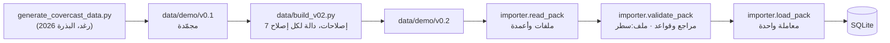

# 07 — خط البيانات: من حزمة رغد إلى قاعدة البيانات

## السلسلة قابلة لإعادة الإنتاج بالكامل

| الحلقة | كيف نتحقق | الاختبار |
|---|---|---|
| مولّد رغد ← v0.1 | تشغيل المولّد في مجلد مؤقت ومقارنة الملفات بايتًا ببايت | `test_v01_matches_raghads_generator` |
| v0.1 ← v0.2 | `build_v02.py --check` | `test_v02_matches_its_transform` |
| v0.2 ← قاعدة البيانات | تحميلان ← نفس البصمة (fingerprint) | `test_loading_twice_gives_the_same_database` |

## الإصلاحات السبعة (v0.1 ← v0.2)

التفاصيل في `data/demo/README.md`. ملخص:
- **R7:** إزاحة التواريخ 1463 يومًا، فتصبح 13–15 أكتوبر 2030 بنفس أيام الأسبوع.
- **R4 + R1:** مهارات S03 في حدث اليابان أصبحت bundle واحدًا (مسعف + إسعاف متقدم + يابانية في الشخص نفسه).
- **R6:** أهمية ونوع لكل موقع.
- **الهرمية:** الإسعاف المتقدم يستوفي الأساسي.
- **R1:** قالب `MISSING_SKILL`.
- **R2:** لا عربية في G1.
- **الساعات:** `hours_before_window`.

## ثلاث خطوات في المستورد، ولماذا منفصلة

1. **`read_pack`:** هل الملفات الأربعة عشر موجودة؟ هل فيها الأعمدة المطلوبة؟ الأعمدة الزائدة مقبولة، فهذا يسمح للفريق بإضافة أعمدة دون كسر شيء.
2. **`validate_pack`:** كل مرجع بين ملفين، وكل قاعدة كانت قاعدة البيانات سترفضها، لكن برسالة مفهومة:
   - `assignment.csv:2: unknown employee 'E999'` بدل `IntegrityError: FOREIGN KEY constraint failed`.
   - يجمع **كل** المشكلات ويطبعها معًا، فلا تُصلح خطأً لتكتشف التالي.
3. **`load_pack`:** يمسح بيانات CoverCast ويكتب الجديدة داخل `transaction.atomic`. إن فشل أي سطر لا يتغير شيء (`test_error_during_writing_rolls_everything_back`).

**الحماية من المسح الخطأ:** `load_demo` يرفض العمل إن كانت قاعدة البيانات غير فارغة، إلا مع `--reset`، لأنها قد تحتوي اعتمادات أُجريت أثناء العرض.

## ما لا يُستورد

| الملف | لماذا |
|---|---|
| `reason_templates.csv` | يُتحقق منه فقط (كل رمز استبعاد له قالب). النصوص تدخل الكود في المرحلة 5 |
| `gap_definitions.csv` | نتائج **متوقعة** للاختبار، لا مدخلات. المحرك يكتشف الفجوات بنفسه (R3) |
| `current_site_code` و`hours_worked_this_week` في employee.csv | مشتقان: الموقع الحالي من التكليفات، والساعات من `hours_before_window` + التكليفات |
