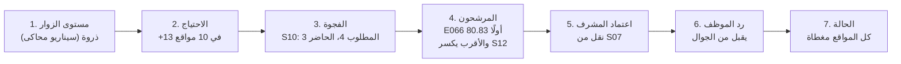

# 14 — سيناريو العرض

**الحالة:** مكتمل. رُوجع في المرحلة 9، ومؤتمت في `coverage/tests/test_e2e_browser.py`. **وأُضيف الجزء الثاني (ضغط الزوار) في P0، ومؤتمت أيضًا.**

**كل ما في العرض محاكاة**، ويُقال ذلك في الدقيقة الأولى.

## الوقائع المزروعة في البيانات (محققة بعد `load_demo`)

| الحالة | الموقع والمناوبة | ما يجب أن يحدث |
|---|---|---|
| **G1**: اليوم الوطني الياباني (الحدث 1، 09:00–14:00) | S03، صباح الإثنين 14 أكتوبر 2030 | المكلّفان E006 وE018 لا يتحدثان اليابانية ← خانة واحدة: مسعف يتحدث اليابانية |
| **G2**: عدم حضور E019 (أُبلغ 14:20) | S10، مساء الثلاثاء 15 أكتوبر 2030 | الموقع ينزل تحت حده الأدنى ← فجوة مؤكدة |

## الأشخاص في G1

| الشخص | الحقيقة المزروعة | النتيجة المتوقعة |
|---|---|---|
| نوره القحطاني (E061)، معارة | تحمل المهارات الثلاث، ونطاقها C/D/E، وموقعها S12 فيه فائض | الأولى، مرشحة |
| خالد الشمري (E012)، متعاقد | يحمل الثلاث، وليست له مناوبة يوم الحدث (يُستدعى)، وساعاته بعد التكليف 48 من 48 | الثاني، احتياطي |
| ريم العنزي (E060)، متطوعة | الأقرب، لكن شهادتها تنتهي 13 أكتوبر، أي قبل الحدث بيوم | مستبعدة: `CERT_EXPIRED` |
| احمد الدوسري (E053)، معار | يحمل الثلاث، لكن نطاقه A/B فقط | مستبعد: `SCOPE_OUT` |

**مثبت في المرحلة 5:** المحرك يطابق الحساب اليدوي: نوره 60.83، وخالد 45.00، والبقية 74 `MISSING_SKILL`.

**سطر المقارنة على الشاشة:**
- **G1** (النص الفعلي على الشاشة): «كان الاختيار سيقع على احمد الدوسري، على بعد 10 دقائق. لكن الموقع خارج نطاق الإعارة، ونقله يُنقص البوابة الشمالية شخصًا واحدًا.»
- **G2:** «الأقرب كان سيختار صالح (10 دقائق): خارج نطاق إعارته، ويترك S09 ناقصًا شخصًا». وCoverCast يرشّح غادة، متطوعة في النقل والحشود، أي من نفس تخصص الغائبة.

## مسار العرض على الشاشة (مجرَّب في متصفح حقيقي)

1. **الدخول** بحساب المشرف (`create_supervisor`).
2. **لوحة الاثنين 14 أكتوبر:** في الأعلى «يحتاج قرارك: فجوة واحدة». المقعد الفارغ المخطط بالكهرماني مكتوب عليه «إسعاف أولي متقدم + اليابانية + مسعف». وتحته كل المواقع، 23 منها مغطاة.
3. **«اختر بديلًا»:**
   - المقعد كبيرًا، وسببه «اليوم الوطني لليابان».
   - «فحصنا 80 موظفًا بثماني قواعد. 2 فقط يجتازونها كلها».
   - نوره 60.83 بشريط من خمسة أجزاء وأسبابها، ثم خالد 45.00.
   - سطر المقارنة الأحمر مع «الأقرب».
   - أسباب استبعاد الـ78 مجمّعة.
4. **«اعتماد نوره»:** رسالة تأكيد تذكر النقل من المركز الطبي، ثم «تم اعتماد نوره. المقعد محجوز الآن بانتظار الرد»، مع رابط الموظف وزر نسخه.
5. **رابط الموظف** يُفتح على الجوال: «مرحبًا نوره»، والموقع والوقت، وزرّا «أقبل التكليف» و«أعتذر».
6. **العودة إلى اللوحة:** G1 لم تعد في «يحتاج قرارك»، ونوره في S03 بإطار متقطع «بانتظار الرد».
7. **(اختياري) غياب حي:** اضغطي اسم مسعف في S01، ثم «عدم حضور»، فتظهر فورًا فجوة مؤكدة حمراء «مسعف».
8. **الثلاثاء 15 أكتوبر:** G2 حمراء، ومريم مشطوبة («غياب مسجّل، لا يُحسب»)، والمقعد الفارغ «إدارة الحشود»، والمرشحة غادة.

**قبل كل تمرين:** `python manage.py load_demo --reset`.

**هذا المسار نفسه مؤتمت** في `coverage/tests/test_e2e_browser.py`. لو تغيّر شيء يكسر العرض، يفشل `manage.py test` قبل يوم العرض.

**النص على الشاشة بعد E-13:** «الأقرب: على بعد 10 دقائق من الموقع» لنوره، و«على بعد 60 دقيقة من الموقع» (محايد) لخالد.

الصور: `docs/screens/`.

## الجزء الثاني: من ضغط الزوار إلى خانة مغطاة (P0، 15 أكتوبر 2026)

**التحضير:**
```
python manage.py load_demo --reset --scenario riyadh_peak
python manage.py import_forecast forecast/out/export/osaka_replay.json
```

**يُقال قبله:** هذا يوم **محاكى** في الرياض 2030، ومستواه «ذروة» مفروض افتراضًا. ليس تنبؤًا بحضور الرياض. وقيم الزيادة افتراضات اعتمدها الفريق، لا معايير رسمية.

### رحلة المستخدم



| الخطوة | ما يظهر على الشاشة (محقق في `test_forecast_to_coverage_journey`) |
|---|---|
| 1 | لوحة الخميس 24 أكتوبر 2030: «ضغط الزوار: ذروة»، ووسم متقطع «سيناريو محاكى، ليس تنبؤًا» |
| 2 | «أثره على الاحتياج: +13 في 10 مواقع»، وجدول الفئات: البوابات +2 لكل موقع (S04–S06)، والحشود +1 (S10)، وخدمة الزوار +1 (S08، S09)، والإسعاف +1 (S01–S03، S12) |
| 3 | «يحتاج قرارك: فجوة واحدة». محطة النقل والمكوكات (S10): «المطلوب = 3 حد أدنى + 1 بسبب ضغط الزوار: ذروة». المقعد الفارغ «إدارة الحشود». فجوة **متوقعة** (كهرمانية)، لأن الحد الأدنى مستوفى |
| 4 | 11 مؤهلًا من 80. الأولى ليلى (E066) بدرجة 80.83: على بعد 10 دقائق، ونقلها لا يكسر مركز العمليات (S07 يبقى 2 من 2). و«الأقرب المؤهل» كان سيختار E064 من المركز الطبي، فيُنقصه شخصًا |
| 5 | «اعتماد ليلى» ← نقل من S07، والمقعد محجوز بانتظار الرد |
| 6 | الرابط على الجوال ← «أقبل التكليف» |
| 7 | اللوحة: «لا شيء ينتظر قرارك» |

**ثم إعادة عرض أوساكا** (زر «إعادة عرض أوساكا 2025»، أو `/board?date=2025-09-13`):
- وسم «بيانات رسمية · أوساكا 2025»، ونص «ليس توقعًا للرياض 2030».
- خط أرقام فيه مناطق المستويات الثلاث، ونطاق 80%، والمتوقع (209,837)، والفعلي (218,130). كلاهما في «ذروة».
- «صدر التوقع بتاريخ 2025-09-08، قبل 5 أيام». والحدود من بيانات حتى ذلك التاريخ فقط.
- «لا مناوبات في هذا اليوم»، والأثر «للتوضيح فقط».

**ما يُقال عن الدقة، إن سُئل:** على 28 يومًا أخيرة من أوساكا، `seasonal_naive` (المختار بالبروتوكول) أخطأ 3.2% (WAPE)، وChronos-2 2.4%. هذه أرقام أوساكا لا الرياض (`18-forecast.md` §9).

**الأرقام كلها مشتقة يدويًا قبل الكود:** `data/demo/scenario_riyadh_peak/README.md`.

**الصور** (بتصميم شهد، 15 أكتوبر 2026):
- `docs/screens/login.png`.
- `docs/screens/board.png` (G1).
- `docs/screens/forecast-riyadh-scenario.png`.
- `docs/screens/candidates-scenario.png`.
- `docs/screens/approve-dialog.png`.
- `docs/screens/board-waiting.png`.
- `docs/screens/offer-mobile.png`.
- `docs/screens/forecast-osaka-replay.png`.

الصور الأقدم في المجلد (`approved.png`، `after-absence.png`، `candidates-g1.png`) بالتصميم السابق.

**تغيّران في المسار (15 أكتوبر 2026):**
1. **«اعتماد …» يفتح نافذة تأكيد** داخل الصفحة: من أين وإلى أين، وأثر القرار، وتنبيه إن اقترب الموظف من سقف الساعات. لا يُرسل شيء قبل «تأكيد الاعتماد».
2. **اللوحة تتحدّث وحدها كل 5 ثوانٍ:**
   - بعد الاعتماد تظهر «بانتظار ردّ واحد» بالأزرق.
   - بعد قبول الموظف تصير «لا شيء ينتظر قرارك» دون إعادة تحميل.
   - يكفي ترك اللوحة مفتوحة على شاشة المشرف أثناء العرض.

## جلسات اختبار الاستخدام (خطة بحث فريق UX)

- **دليل الجلسة** (صفحة مستقلة) يحوّل مهام خطة البحث الثلاث إلى نص يُقرأ للمشارك، مع الإجابة الصحيحة كما تظهر على الشاشة، وما يُراقب.
- **زمن الاعتماد يُقاس من النظام:** `python manage.py session_report --last-minutes 20`. يُحسب من آخر فتح لشاشة المرشحين إلى ضغط «اعتماد»، ثم إلى رد الموظف.
- **بين مشارك وآخر:** `python manage.py load_demo --reset`.

