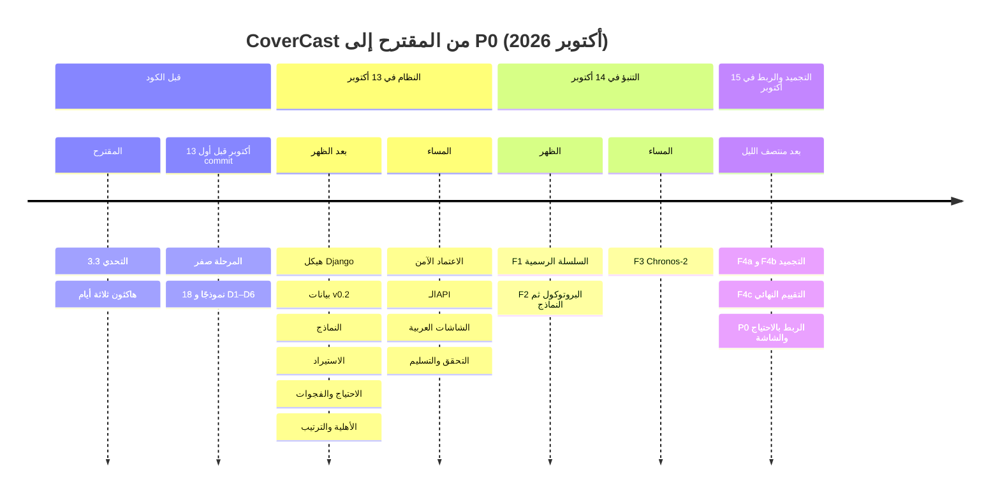

# 22 — رحلة التطوير

> **المصادر:** تاريخ git (كل commit بتاريخه، بتوقيت الرياض)، وتقارير المراحل (`09`)، وسجل الأخطاء (`11`)، وسجلات القرار (`adr/`).
> - التفاصيل في تلك الملفات، وهذه الوثيقة الخيط الذي يربطها.
> - ما قبل 13 أكتوبر 2026 مصدره المقترح وسجل الجلسة فقط، ولا commit فيه.

## 1. المراحل على خط الزمن

## 2. المعالم في git

| التاريخ والوقت | commit | المعلم |
|---|---|---|
| 13 أكتوبر 14:25 | `962a5af` | المرحلة 1: هيكل Django بتطبيقين |
| 13 أكتوبر 14:26 | `eb2d99f` | بيانات v0.2 بسكربت تحويل (ADR 0007) |
| 13 أكتوبر 14:30 | `59fc119` | المرحلة 2: 18 نموذجًا بقيود قاعدة بيانات، و45 اختبارًا |
| 13 أكتوبر 14:33 | `9abd890` | المرحلة 3: `load_demo` ذري، ومتحقق، ولا يتكرر |
| 13 أكتوبر 15:56 | `2988331` | المرحلة 4: الاحتياج والفجوة بعدين (عدد ومهارة) |
| 13 أكتوبر 16:03 | `5a50a92` | **توقعات G1 اليدوية قبل المحرك** |
| 13 أكتوبر 16:10 | `15a9777` | المرحلة 5: ثماني قواعد، والترتيب من 100، والأقرب المؤهل |
| 13 أكتوبر 18:30 | `834ad6c` | قرار A-15: الخانة العامة تشترط مهارات الموقع |
| 13 أكتوبر 18:38 | `8ea55d7` | المرحلة 6: الاعتماد الآمن، والرابط الموقّع، والغياب |
| 13 أكتوبر 18:50–19:06 | `ed04ea8`، `3e6bae4` | المرحلة 8: الـAPI والشاشات العربية |
| 13 أكتوبر 19:37 | `39f830d` | المرحلة 9: التحقق الشامل |
| 13 أكتوبر 19:51 | `5a9537a` | المرحلة 10: التسليم |
| 14 أكتوبر 00:15 | `78ad29a` | `session_report` لجلسات الاستخدام |
| 14 أكتوبر 12:54 | `42e4f25` | F1: 184 يومًا رسميًا لأوساكا |
| 14 أكتوبر 13:15 | `47b580f` | **البروتوكول قبل أي سطر نموذج** |
| 14 أكتوبر 13:18 | `f0221f1`، `7c11c81` | إصلاح الختم (E-14)، ثم نتائج F2 |
| 14 أكتوبر 17:38 | `034594e` | **إعداد Chronos-2 قبل أي تشغيل** |
| 14 أكتوبر 19:18 | `6342029`، `9925ff9` | ملفات Chronos-2 كما وصلت، ثم مقارنة ثلاثية |
| 15 أكتوبر 00:09 | `20da6fa`، `f77c24f` | F4a ثم **التجميد** |
| 15 أكتوبر 02:47 | `e05c822` | F4c كما وصل |
| 15 أكتوبر 02:54 | `b8713f1` | **أرقام سيناريو الرياض قبل الكود** |
| 15 أكتوبر 02:55–03:10 | `9291b1a`، `a3f5833`، `e7b3d5f` | P0: التصدير، والتشغيلات، والمحرك، واللوحة |
| 15 أكتوبر | `8886e57` | إصلاح E-17 |

**نمط يتكرر:** كل ما يحدد «الجواب الصحيح» دخل git **قبل** الكود الذي يُقاس به: توقعات G1، والبروتوكول، وإعداد Chronos-2، والتجميد، وأرقام السيناريو. ترتيب الـcommits هو الدليل.

## 3. مشكلات وكيف حُلّت

| | المشكلة | كيف اكتُشفت | الحل | الدرس |
|---|---|---|---|---|
| E-01، E-12 | `load_demo --reset` يفشل على مراجع `PROTECT` داخل الجدول نفسه | التشغيل الفعلي | فك الارتباط قبل الحذف | المرجع الذاتي يحتاج معاملة خاصة |
| E-02 | تجربة تخريب على `models.py` لم تُفشل الاختبار | التخريب نفسه | التخريب على ملف الـMigration، فقاعدة الاختبار تُبنى منه | النموذج والـMigration مصدران مختلفان |
| E-10 | اختبار ناقص في صفحة الموظف | تجربة تخريب | اختبار يلتقطه | النجاح وحده لا يقيس الحراسة |
| E-05 | `/dev/null` غير موجود على Windows | تشغيل نوف على Windows | `io.StringIO()`، و`.gitattributes` لملفات البيانات | نجاح Linux لا يثبت Windows |
| E-06 | ساعات المنقول أقل بـ8 | التوقعات اليدوية (`5a50a92`) | المناوبة المستهدفة تُضاف دائمًا | التوقع المكتوب قبل الكود يكشف الخطأ |
| E-13 | «الأقرب» لكل مرشح، و«10 دقيقة» | غير مسجل في E-13 | سبب محايد وصيغة عدد عربية | النص على الشاشة معلومة تُختبر |
| E-14 | ملفات الاختبار النهائي كُتبت أثناء تجربة تخريب | ظهور المجلد في المستودع بعد `9190641` | حُذفت دون فتح، وختم أشد. **لا إعادة كتابة للتاريخ** (قرار نوف) | الحارس لا يقدر على كسر ما يحرسه |
| E-15 | حارس «قبل F4c» يفشل بعد F4c المعتمد | تشغيل الاختبارات | استبداله بحارس للحالة الجديدة | الحارس المؤقت يُكتب بشرط انتهائه |
| E-16 | سيناريو 17 أكتوبر سيغيّر G1/G2 | الاشتقاق اليدوي | نقله إلى 24 أكتوبر | «لا يتغير» يُحسب ولا يُفترض |
| E-17 | 7 اختبارات لم تُشغَّل (دالة مساعدة اسمها `run`) | مقارنة العدد المتوقع بالفعلي | `make_run` | «OK» لا تعني أن كل اختبار شُغّل |

السجل الكامل (E-01…E-20) في `11-errors-and-fixes.md`.

## 4. قرارات مهمة وبدائلها

| القرار | البديل | المقايضة | المرجع |
|---|---|---|---|
| حزمة رغد بتواريخ 2030 | يوم أوساكا | قصة تشغيلية كاملة، مقابل بيانات محاكاة | ADR 0001 |
| الفجوة بعدان (عدد ومهارة) | `required − active` | تعقيد أكبر، لكنه يرى G1 | المرحلة صفر §9.3 |
| منطق الأعمال في services نقية | في views أو models | ملفات أكثر، مقابل اختبار بلا قاعدة بيانات ونسخة واحدة | `02-architecture.md` |
| الاعتماد قد يكون نقلًا، والرفض يعيده | تكليف جديد دائمًا | منطق أعقد، مقابل عدم ترك موقع ناقصًا | ADR 0008 |
| التنبؤ خارج Django | داخله | ملف وسيط، مقابل خادم بلا PyTorch | ADR 0009 |
| قاعدة اختيار مسجلة مسبقًا بعتبة نقطة | أدق نموذج رقميًا | قد يُترك نموذج أدق، مقابل اختيار لا يتأثر بالنتائج | `docs/18` §8 |
| تشغيلات بوضعين | آخر مستورد | migration، مقابل فصل مفروض بين الرسمي والمحاكى | ADR 0011 |

## 5. ما نُفذ وما أُجّل

| منفذ ومختبر | مؤجل بقرار |
|---|---|
| استيراد الحزمة، والاحتياج، والفجوات، والأهلية، والترتيب، والمقارنة بالأقرب | P1: ملف الموظف للقراءة، وسبب الاعتذار، والوضع الليلي، وتنبيه المرشح المشترك بين فجوتين |
| الاعتماد الآمن، والرابط الموقّع، والغياب | P2: الدخول والدعوات واستعادة كلمة المرور، والتنبيهات (SMS/بريد)، والإعدادات، والإحصاءات، و«تكليفاتي» |
| الـAPI (5 نقاط JSON وصفحة العرض) والشاشات العربية RTL، ومساران كاملان في المتصفح | IMP-01: حماية المهارات النادرة (تطوير قادم) |
| سلسلة أوساكا الرسمية، و3 نماذج، والتجميد، والتقييم النهائي | MILP وARIMA (مرجع فقط) |
| تصدير إعادة العرض، والتشغيلات، وربط المستوى بالاحتياج، وسيناريو الرياض، ولوحة «ضغط الزوار» | قبل أي نشر حقيقي: PostgreSQL، وحد لمحاولات الدخول، وإرسال الرابط، و`COVERCAST_HTTPS=1` (`17-resume-here.md`) |

## 6. دروس عامة

1. **الجواب الصحيح يُكتب قبل الكود،** ويدخل git قبله، فيصبح ترتيب الـcommits دليلًا لا ادعاءً.
2. **كل حماية تُجرَّب بكسرها.** إن لم يفشل اختبار عند الكسر، فالحماية غير مثبتة.
3. **الأفضل رقميًا ليس دائمًا المختار.** والقول الصادق يذكر الاثنين ولماذا.
4. **المصدر جزء من البيانات:** رسمي أو محاكى، أوساكا أو الرياض. يُفرض في قاعدة البيانات، ويُكتب على الشاشة بالكلمات.
5. **الأرقام تُعدّ ولا تُفترض:** عدد الاختبارات، و«لا يتغير G1/G2». كلاهما كشف خطأ حين حُسب (E-16، E-17).
