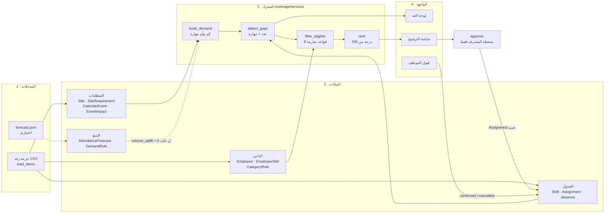
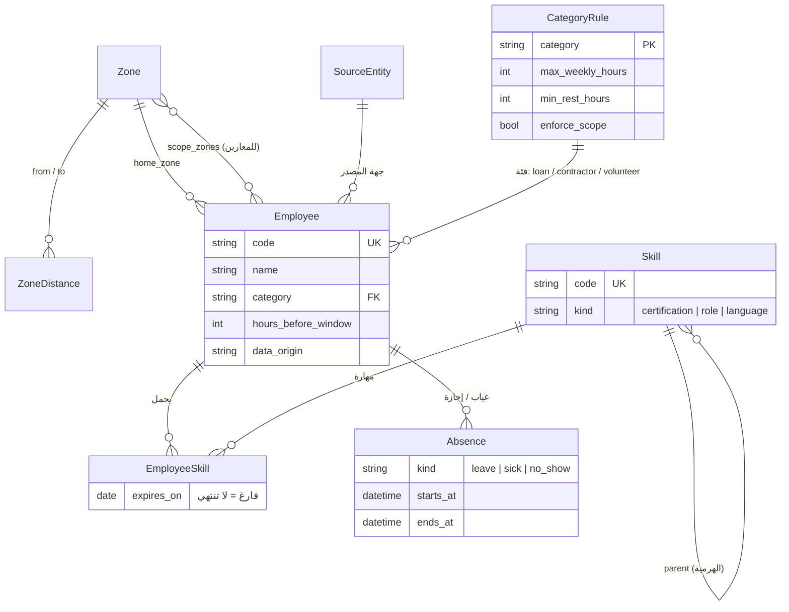
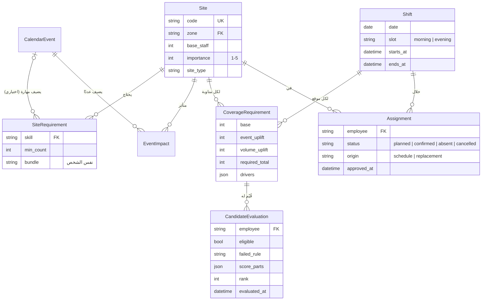
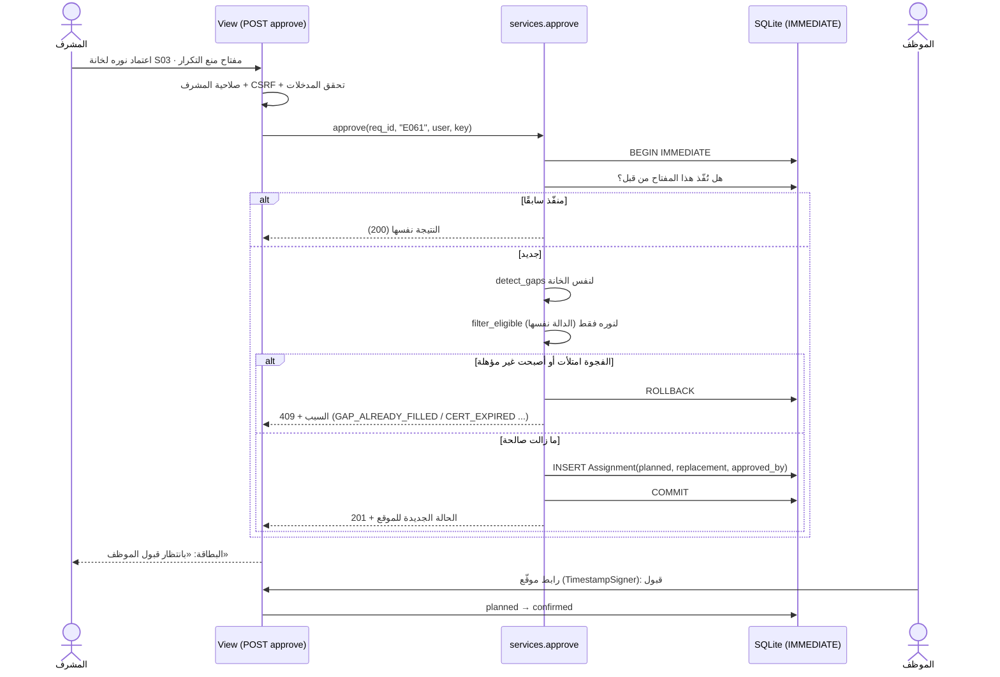
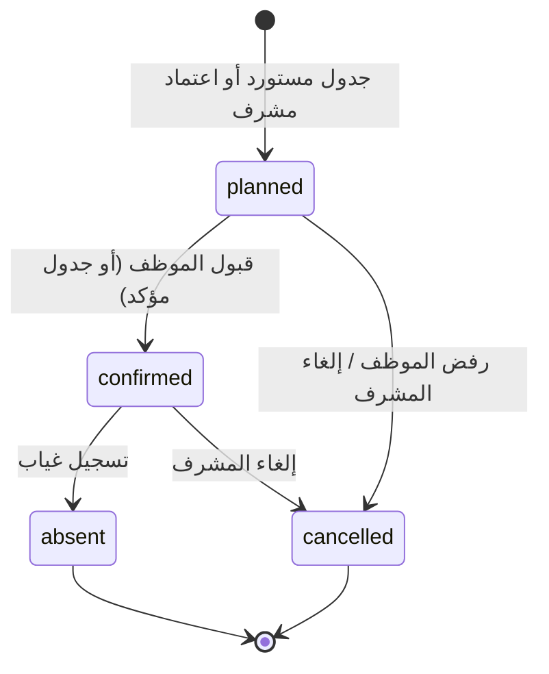

# CoverCast — المرحلة صفر: التدقيق والمتطلبات والمعمارية

> **ملاحظة لاحقة (المرحلة 10، 13 أكتوبر 2026):** هذه الوثيقة سجل تاريخي معتمد ولم تُعدّل. ما خُطط فيها ولم يُبنَ: أمر `import_forecast` (المرحلة 7 اختيارية)، وملف `overrides.csv` (بُنيت v0.2 بسكربت `data/build_v02.py` بدلًا منه). وأسماء الاختبارات في §10 مخطط أولي؛ الأسماء الفعلية في `08-testing-strategy.md`. الحالة الحالية في `17-resume-here.md`.

**الحالة:** **معتمدة** (13 أكتوبر 2026): القرارات D1–D5 كما اقتُرحت، وإصلاح البيانات R1–R7 نفّذناه نحن. D6 مؤقتًا: Git محلي + ملف مضغوط.
**التاريخ:** 13 أكتوبر 2026
**المراجع:** تقرير «CoverCast — مراجعة شاملة واستشارة تقنية» بتبويبيه (الأصلي وتحديث 13 أكتوبر)، وحزمة رغد `CoverCast_data_v0.1.zip`، وملف محمد `CoverCast_Data.xlsx` مع قاموس البيانات، والمقترح الأصلي PDF.

**مفتاح الوسوم في هذه الوثيقة:**
- **[معتمد]** قرار وارد في التقرير أو اعتمدتِه صراحة.
- **[توصية]** رأيي الهندسي، ويحتاج موافقتك.
- **[افتراض]** قيمة نحتاجها للتشغيل ولا مصدر لها، وتُوثّق في `12-assumptions.md`.
- **[محقق]** شيء شغّلته أو فحصته بنفسي على الملفات.

---

## 0. الخلاصة في سبعة أسطر

1. **المشروع جديد بالكامل:** لا مستودع، ولا كود، ولا Migrations. لا يوجد ما يُحذف أو يُعدّل.
2. **حزمة رغد قابلة لإعادة الإنتاج بالضبط [محقق]:** أعدت تشغيل مولّدها فخرجت الملفات الستة عشر مطابقة بايتًا ببايت، وحالات العرض الأربع تتحقق. هذه أساس أمر `load_demo`.
3. **البرومبت يتعارض مع أولويته رقم 1.** يطلب التنبؤ بالحضور، وإعادة تشغيل يوم أوساكا، ونموذج الـ16 جدولًا كما هي. لكن تحديث 13 أكتوبر، وهو الأعلى أولوية حسب البرومبت نفسه، أخرج التنبؤ من الـMVP واعتمد حزمة رغد وسيناريوها. التفاصيل في القسم 4، والقرار لكِ.
4. **الفجوة نوعان لا نوع واحد:** نقص في العدد، ونقص في مهارة. فجوة العرض G1 عددها مكتمل (2 من 2)، والناقص «مسعف يتحدث اليابانية في شخص واحد». المعادلة `gap = required − active` وحدها لا تراها، فالمحرك يحسب البعدين (القسم 9).
5. **منع التكليف المزدوج على SQLite** يقوم على ثلاث طبقات: قيد فريد مشروط، ومعاملة بوضع `IMMEDIATE`، وإعادة فحص الأهلية داخل المعاملة. `select_for_update` لا يعمل على SQLite، فلا نعتمد عليه (القسم 8).
6. **أقترح 18 نموذجًا بدل 16:** حذف واحد، وإضافة ثلاثة، ولكل تغيير سبب (القسم 7).
7. **هذه البيئة السحابية مؤقتة وتُمسح.** الكود يجب أن يعيش في مستودع GitHub من أول سطر، وGitHub غير مربوط بحسابك هنا حاليًا (القرار 6).

---

## 1. فهمي لـ CoverCast

**المشكلة:** في موقع حرج مثل نقطة إسعاف، يتغير الاحتياج من يوم لآخر بسبب يوم وطني أو وفد أو غياب مفاجئ. والقوى العاملة موزعة على ثلاث فئات (معارون ومتعاقدون ومتطوعون)، ولكل فئة قيودها. اليوم يكتشف المشرف الفجوة متأخرًا، ويسدها بأقرب شخص متاح. وكثيرًا ما يكون هذا الشخص غير مؤهل، أو يفتح سحبُه ثغرةً في موقع آخر.

**ما يفعله CoverCast في جملة:** يحسب لكل موقع ومناوبة ما يجب أن يكون (العدد والمهارات)، ويقارنه بما هو موجود فعلًا، ثم يرتّب البدلاء المؤهلين بأسباب مكتوبة، ويترك القرار للمشرف.

**تشبيه:** المحرك يشبه موظف حجوزات في مستشفى. لا يقرر من يُعالَج، لكنه يقول للطبيب المناوب: «غرفة 3 تحتاج ممرضة تتكلم اليابانية غدًا. هذه الوحيدة المتاحة التي لن يتعطل قسمها إذا انتقلت، وهذه أسباب استبعاد الأخريات».

**المبادئ الخمسة [معتمد]:**

| المصدر | يحدد | في الكود |
|---|---|---|
| الفعاليات | **أي** مهارة نحتاج | `SiteRequirement` بأسطر مرتبطة بحدث |
| التنبؤ (لاحقًا) | **كم** شخصًا إضافيًا | `DemandRule` × مستوى الضغط |
| الجدول | **من** موجود فعلًا | `Assignment` بحالة فعّالة |
| المحرك | الفجوة والمؤهلون | `coverage/services/` |
| المشرف | القرار النهائي | `approve()` لا يُستدعى إلا من فعل بشري |

---

## 2. تدقيق حالة المشروع والملفات

### 2.1 المستودع

| البند | الحالة |
|---|---|
| كود Django أو Migrations | لا يوجد. المشروع جديد |
| مستودع Git | لا يوجد. GitHub غير مربوط بالجلسة |
| Python في البيئة | 3.13 |
| Django | غير مثبت. آخر نسخة 6.1.2، وآخر LTS هي 5.2.18 [محقق من pip] |
| مستندات مشروع «EXPO 2030» في Claude | فارغ (لا مستندات) |

### 2.2 جرد ملفات البيانات

| الملف | المصدر | رسمي / محاكى | الحالة | الاستخدام |
|---|---|---|---|---|
| `CoverCast_data_v0.1.zip` (16 CSV + مولّد + README) | رغد | محاكى بالكامل | قابل لإعادة الإنتاج [محقق] | **أساس `load_demo`** |
| `CoverCast_Data.xlsx` + قاموس البيانات (15 صفحة) | محمد | محاكى، ويوم واحد بالدقيقة | متسق داخليًا، وعالمه مختلف (20 موقعًا، أدوار لا مهارات) | مرجع لفكرتين: مقارنة «الأقرب»، وأهمية الموقع. لا يُستورد |
| `CoverCast_datasets.xlsx` (الأول) | محمد | 180 من 184 يوم حضور محاكاة | استُبدل بحزمة رغد | الأيام الوطنية الرسمية لأوساكا فقط، إن احتجناها لاحقًا |
| `CoverCast_Data_Dictionary.pdf` | محمد | — | يصف ملف محمد الجديد | قائمة فحوص الجودة الـ28 تُحوّل إلى اختبارات |
| مخطط البيانات v0.1 PDF | رغد | — | 18 جدولًا | مرجع لتصميم النماذج |
| `gen_data.py` و`engine.py` و`engine.js` وتقرير محمد | محمد | — | **لم تصلني** | ليست مطلوبة للبناء |

### 2.3 ما تحققت منه بنفسي في حزمة رغد

- **إعادة التوليد:** الملفات الستة عشر مطابقة بايتًا ببايت (البذرة 2026، المحاولة الأولى).
- **السلامة:** لا تكليف مزدوج، ولا شخص بمناوبتين في يوم، والساعات ≥ 8 × عدد المناوبات ولا تتجاوز السقف، وكل موقع مغطى عددًا ومهارةً في المناوبات الست، عدا الفجوتين المزروعتين.
- **الفجوة G1** (الموقع S03، صباح 12 أكتوبر): مقيّمها المرجعي يعطي 15 مؤهلًا، منهم 11 يستوفون 1 من 4 فقط (العربية، التي يتحدثها الثمانون كلهم). هذا ما يعالجه الإصلاح R1 في القسم 4.
- **أسماء الأعمدة والمفاتيح:**
  - `employee_code`: مفتاح الموظف.
  - `site_code`: مفتاح الموقع.
  - المناوبة: مفتاحها `(date, label)`.
  - الأحداث: مرقّمة بأعداد صحيحة.
  - `loan_scope_zones`: نص مفصول بفاصلة منقوطة.
  - `expires_on`: فارغ يعني أن الشهادة لا تنتهي.
  - الأوقات بصيغة ISO 8601 مع `+03:00`.

### 2.4 الرسمي مقابل المحاكى

كل بيانات التشغيل في الـMVP **محاكاة**. البيانات الرسمية الوحيدة المتاحة هي أرقام حضور أوساكا من النشرات الأسبوعية، وتقويم أيامها الوطنية، وهي خارج المسار الحرج بعد تحديث 13 أكتوبر.
**[توصية]** حقل `data_origin` (قيمته `official` أو `simulated`) على الجداول التي قد تختلط فيها المصادر: `CalendarEvent` و`AttendanceForecast` و`Employee`. وشارة «بيانات محاكاة» ثابتة في الواجهة (NFR-1).

---

## 3. القرارات المعتمدة من التقرير

| # | القرار | المصدر | الحالة |
|---|---|---|---|
| A1 | منتج واحد ومحرك تغطية واحد، لا مساران | التقرير §3 | [معتمد] |
| A2 | `required = base + event_uplift + volume_uplift`، والفجوة تُحسب ولا تُخزّن | §3، §7 | [معتمد] |
| A3 | الفعاليات تضيف المهارة، والحضور يضيف العدد، لمنع الاحتساب المزدوج | §3 | [معتمد] |
| A4 | قيود صارمة ثم درجة مرجّحة من 100 بأوزان ظاهرة. لا ML في الترشيح | §6 | [معتمد] |
| A5 | لا تكليف بلا ضغطة إنسان، وإعادة الفحص لحظة الاعتماد | §8 FR-7، FR-8 | [معتمد] |
| A6 | تطبيقا Django: `workforce` و`coverage`، والمنطق في services | §3 Q10، §7 | [معتمد] |
| A7 | مناوبات بفترات ثابتة + `UniqueConstraint(employee, shift)` مشروط | §3 Q13 | [معتمد] |
| A8 | التنبؤ خارج Django ويصل ملف JSON | §9 | [معتمد]، ونطاقه معلّق (D2) |
| A9 | اعتماد حزمة رغد أساسًا، ونقل مقارنة «الأقرب المؤهل» من محمد | تحديث 13 أكتوبر | [معتمد في التقرير] |
| A10 | إصلاحات حزمة رغد السبعة | تحديث 13 أكتوبر | [معتمد في التقرير]، وتنفيذها عند رغد |
| A11 | التنبؤ بالحضور خارج الـMVP | تحديث 13 أكتوبر | يتعارض مع البرومبت، انظري D2 |
| A12 | واجهة عربية RTL بخط IBM Plex Sans Arabic، وتعمل بلا إنترنت | §8 NFR-4، NFR-6 | [معتمد] |

---

## 4. التعارضات والنواقص

### 4.1 تعارضات بين البرومبت وتحديث 13 أكتوبر

| الموضوع | البرومبت يقول | تحديث 13 أكتوبر / الملفات تقول | الأثر | اقتراحي |
|---|---|---|---|---|
| التنبؤ بالحضور | المرحلة 7 كاملة + شريط 7 أيام (FR-10) | خارج الـMVP | يوم إلى يومين عمل بلا قيمة في العرض | نبني **الواجهات فقط**: النموذجان، والحقل `volume_uplift`، وأمر `import_forecast`. وقيمة `volume_uplift` = 0 عند غياب الملف. والشريط ميزة إضافية بعد اكتمال المسار. **D2** |
| سيناريو العرض | إعادة تشغيل 23 سبتمبر 2025 في أوساكا | سيناريو رغد: اليوم الوطني الياباني + غياب مفاجئ | بيانات رغد لا تحتوي يوم أوساكا أصلًا | سيناريو رغد بتواريخ 2030. **D1** |
| نموذج البيانات | الستة عشر كما في §7 | مخطط رغد 18 جدولًا | تطابق في نحو 12 جدولًا، واختلاف في 6 | دمج مدروس، 18 نموذجًا. **D4** |
| أوزان الترتيب | 30/25/20/15/10 | رغد: ترتيب معجمي (المستوفى، ثم المسافة، ثم الساعات، ثم الفائض). محمد: 100 ناقص الخصومات | ثلاث طرق ترتيب في الفريق | أوزان التقرير بتعريفات محددة لكل مكوّن. **D3** |
| تخزين الفجوة | لا تُخزّن الفجوة | رغد عندها جدول `Gap` | تكرار للحقيقة | لا جدول Gap. سجل التقييم يحفظ وقت الاكتشاف (القسم 7) |

### 4.2 نواقص في البيانات (من تحديث 13 أكتوبر، لم تُصلح بعد)

| # | الإصلاح | المسؤول | إن تأخر |
|---|---|---|---|
| R1 | فصل «شرط» عن «ميزة»، ورمز `MISSING_SKILL` | رغد (البيانات)، ونوف (المحرك) | المحرك يطبقه من جهته، ونحدّث `demo_cases` بأنفسنا |
| R2 | حذف العربية من متطلبات G1 | رغد | نحذفها عند الاستيراد ونوثّق ذلك |
| R3 | الفجوة يستنتجها المحرك لا الملف | نوف | — |
| R4 | عمود `bundle` (المهارات في الشخص نفسه) | رغد | نضيف أسطر حدث S03 يدويًا في ملف تعديلات معلن |
| R5 | زمن استدعاء ثابت لمن هم خارج الدوام | رغد + قرار | [افتراض] 60 دقيقة في `policy.py` |
| R6 | `importance_1_5` لكل موقع | رغد | [افتراض] قيم في ملف تعديلات معلن |
| R7 | نقل التواريخ إلى 2030 | رغد | إزاحة **1463** يومًا (209 أسابيع): من 11–13 أكتوبر 2026 (أحد إلى ثلاثاء) إلى 13–15 أكتوبر 2030 (أحد إلى ثلاثاء). **تصحيح:** كانت هنا 1461، وهي تصل إلى يوم جمعة (انظري `11-errors-and-fixes.md` E-03) |

### 4.3 أشياء لا يحددها أي ملف ولا التقرير

- **تعريف الأسبوع لسقف الساعات.** [افتراض] من الأحد إلى السبت.
- **نقطة بداية الساعات.** رغد تعطي `hours_worked_this_week` شاملة مناوبات النافذة. [توصية] نشتق عند الاستيراد `hours_before_window = hours − 8 × عدد مناوبات النافذة`، ثم نحسب الساعات دائمًا من التكليفات الفعّالة. وإلا ستبقى الساعات قديمة بعد كل اعتماد (القسم 8-E).
- **مهارات «ميزة» لكل موقع.** لا توجد في أي ملف. لذلك مكوّن «مهارات إضافية» محايد في الـMVP (القسم 9.4).
- **تعريف «حمل العمل»** لمكوّن العدالة. [افتراض] عدد التكليفات البديلة في الأيام السبعة الأخيرة.

---

## 5. مكونات النظام ومسؤولياتها



**كيف تُقرأ:** تتدفق البيانات من اليسار إلى اليمين. السهم الوحيد العائد هو ضغطة المشرف، فهي الطريق الوحيد الذي يكتب تكليفًا جديدًا في الجدول. والتنبؤ خط منقّط: إن غاب، يعمل كل شيء آخر كما هو.

### حالات الاستخدام (Use Cases)

| # | الفاعل | الحالة | النتيجة |
|---|---|---|---|
| UC-1 | المشرف | يفتح لوحة الغد | 12 بطاقة بحالاتها، مرتبة بالأخطر |
| UC-2 | المشرف | يفتح فجوة ويرى المرشحين | مؤهلون بدرجات مفصّلة، ومستبعدون بأسبابهم، وسطر المقارنة مع «الأقرب» |
| UC-3 | المشرف | يعتمد مرشحًا | تكليف `planned`، والبطاقة «بانتظار القبول»، أو 409 بسبب واضح |
| UC-4 | المشرف | يسجّل غيابًا مفاجئًا | التكليف `absent`، وفجوة `confirmed` تظهر فورًا |
| UC-5 | الموظف | يفتح رابط العرض ويقبل أو يرفض | `confirmed`، أو `cancelled` وتعود الفجوة |
| UC-6 | فريق البيانات | يشغّل `load_demo` أو `import_forecast` | قاعدة بيانات مطابقة في كل مرة، أو رفض برسالة السطر والسبب |

| المكوّن | المسؤولية | لا يفعل |
|---|---|---|
| `workforce.models` | من الموظف، وماذا يجيد، وما قيود فئته، ومتى يغيب | لا يعرف شيئًا عن المواقع أو المناوبات |
| `coverage.models` | المواقع ومتطلباتها، والمناوبات، والتكليفات، ولقطات الاحتياج | لا منطق أعمال. فقط قيود وتحقق بنيوي |
| `coverage/services/` | كل قاعدة تشغيلية | لا يقرأ `request` ولا يعرف HTTP |
| Views وAPI | استقبال الطلب، والتحقق من المدخلات والصلاحية، واستدعاء الخدمة، وتشكيل الاستجابة | لا قاعدة أعمال واحدة |
| Management commands | الاستيراد والتهيئة | لا يكرر قواعد المحرك. يستدعي الخدمات نفسها |
| Templates وstatic | العرض بالعربية RTL | لا حسابات |

**لماذا اتجاه الاعتماد من coverage إلى workforce فقط؟** `Employee` يحتاج `Zone`. لو وضعنا `Zone` في `coverage` لصار كل تطبيق يعتمد على الآخر. التطبيقان المتشابكان لا يمكن فهم أحدهما أو اختباره بمعزل عن الآخر. لذلك تعيش بيانات المرجع (`Zone` و`ZoneDistance` و`Skill`) في `workforce`.

---

## 6. هيكل المشروع المقترح

```text
covercast/
├── README.md
├── requirements.txt              # Django>=5.2,<5.3 فقط
├── requirements-dev.txt          # coverage (اختياري)
├── manage.py
├── .gitignore                    # .venv/ db.sqlite3 .env __pycache__/
├── config/                       # settings, urls, wsgi
│   └── settings.py               # SECRET_KEY من متغير بيئة، وSQLite بوضع IMMEDIATE
├── workforce/
│   ├── models.py
│   ├── admin.py
│   └── tests/
├── coverage/
│   ├── models.py
│   ├── policy.py                 # الأوزان والسقوف والافتراضات: لا أرقام سحرية في المنطق
│   ├── services/
│   │   ├── __init__.py           # يعرض الدوال الخمس فقط
│   │   ├── types.py              # dataclasses: مدخلات ومخرجات المحرك
│   │   ├── demand.py             # build_demand
│   │   ├── gaps.py               # detect_gaps
│   │   ├── eligibility.py        # filter_eligible
│   │   ├── ranking.py            # rank
│   │   ├── approval.py           # approve, respond
│   │   ├── baseline.py           # «الأقرب المؤهل» للمقارنة
│   │   └── reasons.py            # رموز الأسباب ونصوصها
│   ├── api/                      # views بـ JSON، بلا DRF
│   ├── views.py                  # صفحات HTML
│   ├── templates/coverage/
│   ├── static/coverage/          # CSS، وخط IBM Plex Sans Arabic محليًا
│   ├── management/commands/
│   │   ├── load_demo.py
│   │   └── import_forecast.py
│   └── tests/
├── data/demo/                    # نسخة مجمّدة من حزمة رغد + overrides.csv معلن
└── docs/                         # الملفات الـ17 من البرومبت + adr/
```

**[توصية] بلا Django REST Framework:** الـAPI أربع نقاط أو خمس تُرجع JSON. `JsonResponse` يكفي، ويُبقي التبعيات = Django وحده. إذا نما الـAPI لاحقًا فالانتقال إلى DRF بسيط.
**[توصية] Django 5.2 LTS لا 6.1:** دعمه ممتد حتى أبريل 2028، ومعظم المراجع التعليمية مكتوبة له. وهو يدعم `transaction_mode` لـSQLite (أُضيف في 5.1)، وهو ما نحتاجه في القسم 8.

---

## 7. نموذج البيانات: ERD ومراجعة النماذج

### 7.1 من 16 إلى 18: ما تغيّر ولماذا

| التغيير | السبب |
|---|---|
| **حذف** `SecondmentScope` واستبداله بـ `Employee.scope_zones` (ManyToMany إلى Zone) | الجدول في التقرير لم يكن فيه إلا الموظف والمناطق. هذا بالضبط ما يُنشئه ManyToMany تلقائيًا. نموذج مستقل بلا حقول إضافية = كود زائد بلا فائدة |
| **إضافة** `SiteRequirement` (site, skill, min_count, event?, bundle) | `Site.required_skill` في التقرير حقل واحد، بينما S01 يحتاج مهارتين أساسيتين. وأسطر الحدث تحتاج المكان نفسه. هذا جدول رغد كما هو، مع عمود `bundle` (R4) |
| **إضافة** `Absence` | رغد عندها إجازات في أيام بلا تكليف. وفي التقرير الغياب حالة على التكليف فقط، فلا مكان لإجازة يوم كامل |
| **إضافة** `CategoryRule` | سقف الساعات وفاصل الراحة وفرض النطاق تختلف حسب الفئة. هذه قواعد أعمال حقيقية، ومكانها البيانات لا الكود |
| `EventImpact` تبقى، لكن للعدد فقط (`extra_staff`) | المهارات انتقلت إلى `SiteRequirement`. حقل واحد بمعنى واحد |
| `Site` + `importance` (1–5) | من محمد (R6). تدخل في قرار «هل سحبه يضر موقعه؟» |
| بلا جدول `Gap` (عند رغد) | الفجوة تُحسب من التكليفات. التخزين يعني حقيقتين قد تختلفان |
| بلا `RuleConfig` | الأوزان والهوامش في `coverage/policy.py`: تمر بالمراجعة في Git، ولها اختبارات، ولا يغيّرها أحد من لوحة الإدارة قبل العرض بدقيقة |

### 7.2 ERD

**تطبيق `workforce`: من هم الناس وماذا يجيدون**



**تطبيق `coverage`: أين يجب أن يكونوا، ومن هناك فعلًا** (`Employee` و`Skill` و`Zone` مستوردة من `workforce`)



`AttendanceForecast` و`DemandRule` بلا علاقات مفاتيح: الربط بالمستوى ونوع الموقع، لأن التنبؤ يخص المعرض كله لا موقعًا بعينه.

### 7.3 مراجعة كل نموذج

| النموذج | الحقول الحرجة | القيود | عند الحذف | ماذا لو لم نطبق القيد؟ |
|---|---|---|---|---|
| Zone | code | unique(code) | PROTECT | — |
| ZoneDistance | from_zone, to_zone, minutes | unique(from,to)، check(minutes ≥ 0) | CASCADE | مسافتان متعارضتان لنفس الزوج = ترتيب عشوائي |
| Skill | code, kind, parent | unique(code)، check(parent ≠ self) | PROTECT | حلقة في الهرمية = حلقة لا نهائية عند الفحص |
| SourceEntity | name | unique(name) | PROTECT | — |
| CategoryRule | category (PK)، max_weekly_hours، min_rest_hours، enforce_scope | check(hours > 0) | PROTECT | — |
| Employee | code، category، home_zone، hours_before_window، scope_zones | unique(code)، check(hours ≥ 0)، clean(): لغير المعار `scope_zones` فارغ | PROTECT | معار بلا نطاق = يُستبعد من كل شيء بصمت |
| EmployeeSkill | employee، skill، expires_on | unique(employee, skill) | CASCADE | شهادتان بتاريخين = أيهما نصدق؟ |
| Absence | employee، kind، starts_at، ends_at | check(ends_at > starts_at) | CASCADE | — |
| Site | code، zone، base_staff، importance، site_type | unique(code)، check(1 ≤ importance ≤ 5)، check(base_staff ≥ 1) | PROTECT | — |
| SiteRequirement | site، skill، min_count، event، bundle | unique(site, skill, event)، check(min_count ≥ 1) | CASCADE | سطران لنفس المهارة = عدّ مزدوج |
| Shift | date، slot، starts_at، ends_at | unique(date, slot)، check(ends_at > starts_at) | PROTECT | — |
| CalendarEvent | kind، title، starts_at، ends_at، data_origin | check(ends_at > starts_at) | PROTECT | — |
| EventImpact | event، site، extra_staff | unique(event, site)، check(extra_staff ≥ 0)، clean(): الأحداث المحسوبة في التنبؤ `extra_staff = 0` | CASCADE | **العدّ المزدوج** (القسم 9.2) |
| AttendanceForecast | date، p10، p50، p90، level، model_version | unique(date, model_version)، check(p10 ≤ p50 ≤ p90) | — | — |
| DemandRule | site_type، level، extra_staff | unique(site_type, level) | — | — |
| CoverageRequirement | site، shift، المكونات، `drivers` | **unique(site, shift)**، check(required_total = base + event_uplift + volume_uplift) | CASCADE | لقطتان لنفس الخانة = فجوة تُعد مرتين |
| Assignment | employee، site، shift، status، origin، approved_by، approved_at | **unique(employee, shift) حين status ∈ {planned, confirmed}**، و**unique(employee, site, shift, origin=replacement)** للاعتماد المتكرر | PROTECT | تكليف مزدوج |
| CandidateEvaluation | requirement، employee، eligible، failed_rule، score_parts، rank، evaluated_at | check(eligible أو failed_rule غير فارغ) | CASCADE | استبعاد بلا سبب |

**لماذا PROTECT على الموظف والموقع والمناوبة؟** حذف موظف له تكليفات بطريقة CASCADE يمحو سجل التدقيق بصمت. PROTECT يرفض الحذف ويجبرنا على قرار واعٍ.

---

## 8. سلامة البيانات: البنود A إلى G

**A. سلامة المناوبات.**
- فترات ثابتة (صباحية / مسائية)، وبالتالي «التداخل» = «نفس المناوبة».
- قيد فريد مشروط على `(employee, shift)` للحالات الفعّالة.
- فاصل الراحة (11 ساعة) قاعدة أهلية، لا قيد قاعدة بيانات، لأنه يقارن بين مناوبتين مختلفتين.

**B. هرمية المهارات.** `Skill.parent`: حامل المهارة الأعلى (الإسعاف المتقدم) يستوفي الأدنى (الأساسي)، والعكس غير صحيح.
- الدالة: `holds(employee, skill, on_date)`. تصعد من مهارات الموظف نحو الآباء، ولا تنزل أبدًا.
- اختبار سلبي: حامل الأساسي **لا** يُحسب متقدمًا.

**C. صلاحية الشهادة.**
- تُقارن `expires_on` بتاريخ **المناوبة** (`shift.date`) لا بتاريخ اليوم.
- مثال ريم: شهادتها سارية «اليوم» (11 أكتوبر)، لكنها تنتهي قبل مناوبة 12 أكتوبر، فتُستبعد بـ`CERT_EXPIRED`.
- اللغات والأدوار لا تنتهي: حقلها فارغ دائمًا.

**D. نطاق الإعارة.** يُطبق فقط إن كان `CategoryRule.enforce_scope` صحيحًا لفئة الموظف. ويُفحص أن منطقة الموقع ∈ `scope_zones`.

**E. الساعات الأسبوعية.**
- `hours_after = hours_before_window + 8 × (عدد تكليفاته الفعّالة في الأسبوع نفسه) + (8 إن لم يكن مكلّفًا في هذه المناوبة)`.
- لا تُخزّن الساعات بعد الاعتماد. تُحسب دائمًا من التكليفات، فلا تتقادم.
- الأسبوع من الأحد إلى السبت [افتراض].

**F. CoverageRequirement.**
- صف واحد لكل موقع × مناوبة، بقيد فريد.
- يُعاد بناؤه بـ`update_or_create` داخل معاملة.
- قيد Check يمنع أن يختلف المجموع عن مكوناته.

**G. CandidateEvaluation.**
- كل تشغيل للترشيح يحفظ صفًا لكل موظف قُيّم: مؤهل أو مستبعد، والقاعدة الأولى التي فشل فيها، ومكونات الدرجة، والترتيب.
- يُحفظ دائمًا، حتى لو لم يُعتمد أحد. هذا سجل «لماذا اقترح النظام ما اقترحه».

### SQLite والتزامن: ما هو مضمون وما ليس مضمونًا

| الآلية | على SQLite | قرارنا |
|---|---|---|
| `select_for_update()` | **لا يعمل.** SQLite لا يدعم قفل الصفوف، وDjango يتجاهله | لا نعتمد عليه |
| `transaction.atomic()` بالوضع الافتراضي (DEFERRED) | قارئان قد يبدآن معًا ثم يكتب كلاهما | غير كافٍ وحده |
| `OPTIONS = {"transaction_mode": "IMMEDIATE"}` (Django ≥ 5.1) | كل معاملة تحجز قفل الكتابة من أول لحظة، فالمعاملات الكاتبة تتسلسل | **نستخدمه**، مع `timeout` = 20 ثانية |
| القيد الفريد المشروط | تفرضه قاعدة البيانات دائمًا | خط الدفاع الأخير، و`IntegrityError` يُترجم إلى 409 |

**الحالة التي لا يمنعها القيد الفريد:** مشرفان يعتمدان شخصين **مختلفين** لنفس خانة الفجوة الوحيدة. كلاهما تكليف صالح، فيمتلئ الموقع زيادة عن حاجته.
- الحماية: داخل معاملة `IMMEDIATE` نعيد حساب الفجوة لنفس الخانة قبل الكتابة.
- المعاملة الثانية تنتظر الأولى، ثم ترى الفجوة = 0، فترجع 409 `GAP_ALREADY_FILLED`.

---

## 9. تصميم محرك التغطية

### 9.1 واجهات الدوال

**الفكرة:** نفصل القراءة من قاعدة البيانات عن الحساب.
- طبقة رقيقة تقرأ الجداول وتبني «لقطة» (dataclasses مجمّدة).
- الدوال الأربع الأولى نقية: تأخذ اللقطة وتُرجع نتيجة، بلا ORM.
- تُختبر بلا قاعدة بيانات، وبسرعة، وبحالات حدّية مكتوبة يدويًا.

```python
# coverage/services/types.py  (توضيح للعقد، لا كود نهائي)
@dataclass(frozen=True)
class SkillNeed:
    skills: frozenset[str]          # bundle: كلها في الشخص نفسه
    count: int
    source: str                     # "base" | "event:<id>"

@dataclass(frozen=True)
class Demand:
    site: str; shift: tuple[date, str]
    base: int; event_uplift: int; volume_uplift: int
    skill_needs: tuple[SkillNeed, ...]
    drivers: tuple[Driver, ...]
    @property
    def required_total(self) -> int: ...

@dataclass(frozen=True)
class Gap:
    demand: Demand
    filled: int
    headcount_gap: int
    open_slots: tuple[Slot, ...]    # كل خانة مفتوحة بمهاراتها الشرطية
    nature: str                     # "confirmed" | "anticipated"

def build_demand(site, shift, *, events, impacts, requirements, forecast, rules) -> Demand
def detect_gaps(demand, active_assignees, *, on_date) -> Gap
def filter_eligible(slot, people, *, ctx) -> list[Evaluation]      # كل شخص: مؤهل أو أول قاعدة فشل فيها
def rank(evaluations, *, policy) -> list[Evaluation]               # درجة + مكونات + ترتيب ثابت
def approve(requirement_id, employee_code, *, user, idempotency_key) -> ApprovalResult  # تكتب، داخل معاملة
```

### 9.2 بناء الاحتياج ومنع الاحتساب المزدوج

| المكوّن | مصدره | متى يكون غير صفر |
|---|---|---|
| `base` | `Site.base_staff` | دائمًا |
| `event_uplift` | مجموع `EventImpact.extra_staff` للأحداث المتقاطعة مع المناوبة | أحداث **لا** يراها التنبؤ: وفد، زيارة VIP، مؤتمر |
| `volume_uplift` | `DemandRule[site_type, level]` | فقط عند وجود تنبؤ مستورد. **0 في الـMVP** |
| `skill_needs` | `SiteRequirement` (الأسطر الأساسية + أسطر الأحداث المتقاطعة) | دائمًا |

**قاعدة منع العدّ المزدوج:**
- اليوم الوطني يرفع الحضور، والتنبؤ يراه (متغير `national_day`).
- لذلك أحداث من نوع `national_day` تضيف **مهارة** (سطر في `SiteRequirement`) ولا تضيف **عددًا** (`extra_staff` = 0).
- يُفرض ذلك في `EventImpact.clean()` وفي اختبار.

**نوع الفجوة:** `confirmed` إن كان النقص في `base` أو في مهارة أساسية (غياب أو تكليف ناقص). و`anticipated` إن كان النقص في الإضافات فقط (حدث أو حضور). **G1 من نوع `anticipated`، وG2 من نوع `confirmed`.**

### 9.3 اكتشاف الفجوة: العدد والمهارة معًا

```text
active        = تكليفات الموقع في المناوبة بحالة planned أو confirmed،
                مطروحًا منها من عليه Absence متقاطع
headcount_gap = max(0, required_total − len(active))
skill_slots   = لكل SkillNeed: max(0, count − عدد الحاضرين الذين يحملون كل مهارات الـbundle سارية في تاريخ المناوبة)
open_slots    = skill_slots (لكل منها مهاراته الشرطية)
              + max(0, headcount_gap − len(skill_slots)) خانات عامة (شرطها مهارة الموقع الأساسية)
```

**مثال G1 من بيانات رغد [محقق]:**
- S03 صباح 12 أكتوبر، الحد 2، والمكلّفان: E006 وE018، فـ`headcount_gap = 0`.
- سطر الحدث: (paramedic + adv_first_aid + ja) في شخص واحد. لا أحد من الاثنين يتحدث اليابانية، فـ`skill_slots = 1`.
- النتيجة: **خانة واحدة مفتوحة** شرطها الـbundle الثلاثي. يرتفع العدد إلى 3، وهذا صحيح: الحدث يتطلب شخصًا إضافيًا مؤهلًا.

### 9.4 الأهلية: ترتيب ثابت للقواعد

يُفحص كل موظف بالترتيب أدناه، ويُسجّل **أول** فشل فقط. هكذا يكون لكل مستبعد سبب واحد واضح، والترتيب نفسه اختبار.

| # | القاعدة | رمز الفشل |
|---|---|---|
| 1 | ليس مكلّفًا في هذا الموقع في هذه المناوبة | `ALREADY_ASSIGNED` |
| 2 | لا غياب يتقاطع مع المناوبة | `ABSENT` |
| 3 | يحمل كل المهارات الشرطية (مع الهرمية) | `MISSING_SKILL` (جديد) |
| 4 | شهاداته الشرطية سارية في تاريخ المناوبة | `CERT_EXPIRED` |
| 5 | منطقة الموقع ضمن نطاق إعارته (إن طُبّق النطاق) | `SCOPE_OUT` |
| 6 | `hours_after ≤ سقف فئته` | `HOURS_CAP` |
| 7 | فاصل راحة ≥ 11 ساعة عن تكليفاته الأخرى | `REST_GAP` |
| 8 | إن كان مكلّفًا في مكان آخر: سحبه لا يكسر حد ذلك الموقع ولا مهاراته | `BREAKS_MINIMUM` |

**ملاحظة على الترتيب:** `MISSING_SKILL` يأتي قبل `CERT_EXPIRED`. من **لا يحمل** المهارة أصلًا سببه «لا يملكها». أما من يحملها منتهية فسببه «انتهت». وهذا يحفظ نتيجة ريم المتوقعة.

### 9.5 الترتيب: الدرجة من 100 (أوزان التقرير، بتعريفات محددة) — [توصية، القرار D3]

| المكوّن | الوزن | التعريف المقترح | مثال: نوره |
|---|---|---|---|
| القرب | 30 | `30 × (25 − travel) / 20`، حيث travel بين 5 و25 دقيقة؛ ومن هو خارج الدوام = زمن الاستدعاء (R5) | travel 10 → 22.5 |
| هامش الساعات | 25 | `25 × (cap − hours_after) / cap` | (48−32)/48 → 8.3 |
| مهارات إضافية | 20 | نسبة مهارات «الميزة» المستوفاة. **لا توجد في البيانات الآن، فتُعطى 20 للجميع (محايد)** | 20 |
| أمان السحب | 15 | 15 إن لم يكن مكلّفًا. وإن كان مكلّفًا: `15 × (5 − importance) / 4` (سحبه من موقع أهميته 5 = 0) | من S12 (أهمية تُحدد) |
| العدالة | 10 | `max(0, 10 − 5 × عدد بدائله في 7 أيام)` | 10 |

- **فك التعادل (ترتيب ثابت):** الدرجة تنازليًا، ثم travel تصاعديًا، ثم hours_after تصاعديًا، ثم `employee_code` أبجديًا. لا عشوائية، فالمدخلات نفسها تعطي الترتيب نفسه دائمًا (NFR-2).
- **الوسوم:** `recommended` للأول. و`backup` لمن يقع ضمن هامش ساعتين من سقفه، أو للثاني إن لم يكن موسومًا.
- **تنبيه صريح:** بعد R1 (الشرط) يبقى في G1 مؤهلان فقط: نوره وخالد. هذا **أقوى** للعرض: «من 80 شخصًا، اثنان فقط مؤهلان، وهذا سبب استبعاد كل واحد من الـ78 الآخرين». لكن `demo_cases.csv` يجب إعادة توليده.

### 9.6 الاعتماد: التسلسل



### 9.7 حالات التكليف



- **فعّال (يُحسب في التغطية):** `planned` و`confirmed`.
- **[توصية، القرار D5]** التكليف البديل يُعدّ مغطيًا لحظة الاعتماد، وتظهر البطاقة «بانتظار القبول». إن رفض الموظف تعود الفجوة تلقائيًا، لأنها تُحسب ولا تُخزّن.

---

## 10. مصفوفة قواعد الأعمال

| المعرّف | القاعدة | النوع | المصدر | مكانها في الكود | الاختبار |
|---|---|---|---|---|---|
| BR-01 | الاحتياج = أساسي + حدث + حضور | حساب | §3 | `demand.py` | `test_required_total_components` |
| BR-02 | حدث يوم وطني لا يضيف عددًا | قيد | §3، 9.2 | `EventImpact.clean` + `demand.py` | `test_national_day_adds_skill_not_headcount` |
| BR-03 | الفجوة من التكليفات الفعّالة فقط، بعد طرح الغائبين | حساب | §3 | `gaps.py` | `test_absent_and_cancelled_not_counted` |
| BR-04 | خانات المهارة قبل الخانات العامة | حساب | تحديث 13 أكتوبر R4 | `gaps.py` | `test_g1_is_one_bundle_slot` |
| BR-05 | تمييز confirmed عن anticipated | تصنيف | §3 Q15 | `gaps.py` | `test_gap_nature` |
| BR-06 … BR-13 | قواعد الأهلية الثماني بالترتيب | صارم | §6، رغد، R1 | `eligibility.py` | اختبار لكل رمز + `test_first_failure_wins` |
| BR-14 | الهرمية تصعد ولا تنزل | صارم | §4 | `eligibility.holds` | `test_basic_does_not_satisfy_advanced` |
| BR-15 | الشهادة بتاريخ المناوبة | صارم | رغد | `eligibility.py` | `test_reem_valid_today_expired_on_shift` |
| BR-16 | الدرجة من 100 بخمسة مكونات | ترجيح | §6، D3 | `ranking.py` + `policy.py` | `test_score_parts_sum`، `test_noura_rank_1` |
| BR-17 | ترتيب ثابت عند التعادل | حتمية | NFR-2 | `ranking.py` | `test_tie_break_is_stable` (تشغيل 100 مرة) |
| BR-18 | لا تكليف بلا مشرف | صلاحية | FR-7 | `approval.py` + الصلاحيات | `test_engine_never_writes_assignments` |
| BR-19 | إعادة الفحص لحظة الاعتماد | صارم | FR-8 | `approval.py` | `test_cert_expired_between_view_and_approve` |
| BR-20 | الاعتماد المتكرر لا يكرر التكليف | حتمية | البرومبت §6 | مفتاح منع التكرار + قيد | `test_double_click_same_result` |
| BR-21 | معتمدان متزامنان لخانة واحدة → واحد ينجح | تزامن | البرومبت §6 | `IMMEDIATE` + إعادة الحساب | `test_concurrent_approvals` (قاعدة بيانات ملف، خيطان) |
| BR-22 | المقارنة مع «الأقرب المؤهل» | تفسير | تحديث 13 أكتوبر | `baseline.py` | `test_baseline_breaks_donor_site` |

**عن BR-22 [توصية]:** المقارنة تُحسب داخل محركنا لا من ملف محمد.
- «الأقرب المؤهل» = أقل زمن وصول بين من يحمل المهارات ولم تنتهِ شهادته، **مع تجاهل** أمان السحب والساعات.
- بعد ذلك نحسب: هل كان سحبه سيكسر حد موقعه؟
- هكذا الرقمان من بيانات واحدة وقواعد واحدة، ولا اعتماد على ملف بعالم مختلف.

---

## 11. عقود التكامل

### 11.1 حزمة البيانات (رغد → نوف)

- **العقد:** أسماء ملفات CSV وأعمدتها في v0.1، مع الإضافات التالية في v0.2:

| الملف | عمود جديد | القيم |
|---|---|---|
| `site_requirement.csv` | `bundle` | نص؛ الأسطر بنفس القيمة = في الشخص نفسه |
| `critical_site.csv` | `importance_1_5` | 1–5 |
| `skill.csv` | `parent_code` | رمز مهارة أو فارغ |
| `reason_templates.csv` | صف `MISSING_SKILL` | — |

- **نفس البذرة، وتواريخ 2030، ومن دون العربية في G1، و`demo_cases.csv` مُعاد توليده.**
- **عند الاستيراد:** `load_demo` يرفض أي ملف ينقصه عمود أو فيه مفتاح أجنبي يتيم، ويطبع السطر والسبب. ويُطبق `data/demo/overrides.csv` المعلن إن تأخرت v0.2.

### 11.2 الـAPI (نوف → شهد): قبل/بعد مقارنة بالقسم 9 من التقرير

**لا إعادة تسمية لأي حقل قائم.** كل التغييرات إضافات أو قيم جديدة، وتحتاج موافقتك (D7 ضمن القائمة):

| الحقل | في التقرير | المقترح | السبب | أثره على شهد |
|---|---|---|---|---|
| `requirement.gap_nature` | `"forecasted"` | `"confirmed"` \| `"anticipated"` | لا تنبؤ في الـMVP، و«متوقع بسبب حدث» أدق | قيمتان، ولونان: أحمر وكهرماني |
| `requirement.open_slots` | — | `[{"slot":1,"must_have":["paramedic","adv_first_aid","ja"]}]` | الفجوة قد تكون مهارة لا عددًا | سطر «المطلوب: مسعف يتحدث اليابانية» |
| `candidates[].tag` | — | `"recommended"` \| `"backup"` \| `null` | من حزمة رغد | شارة |
| `candidates[].requirements_met` | — | `"3/3"` | للشرح | نص صغير |
| `excluded[].failed_rule` | قائمة مفتوحة | الرموز التسعة الثابتة (القسم 9.4 + `GAP_ALREADY_FILLED`) | قابلة للاختبار والترجمة | قاموس ترجمة واحد |
| `baseline` | — | `{"employee":"E0xx","travel":5,"breaks_site":"S12","donor_short_by":1}` | مقارنة 13 أكتوبر | سطر المقارنة |
| `score_parts` | proximity، hours_headroom، extra_skills، unassigned، fairness | proximity، hours_headroom، extra_skills، **donor_safety**، fairness | «unassigned» أصبح «أمان السحب» بتعريف أشمل | تسمية شريط واحد |

**نقاط الـAPI:**

| الطريقة | المسار | الغرض | الحماية |
|---|---|---|---|
| GET | `/api/board?date=` | حالة المواقع لمناوبات يوم | مشرف |
| GET | `/api/requirements/{id}/candidates` | العقد 3 | مشرف |
| POST | `/api/requirements/{id}/approve` | `{employee_code, idempotency_key}` | مشرف + CSRF |
| POST | `/api/assignments/{id}/absence` | تسجيل غياب | مشرف + CSRF |
| GET/POST | `/offer/{signed_token}` | قبول أو رفض الموظف | توقيع بانتهاء صلاحية، بلا دخول |

**أخطاء موحّدة:** `{"error": {"code": "GAP_ALREADY_FILLED", "message_ar": "...", "details": {...}}}`، والرموز: 400 / 403 / 404 / 409.

### 11.3 التنبؤ (`forecast.json`) — خارج المسار الحرج

يبقى عقد التقرير §9 كما هو. `import_forecast` يتحقق من:
- البنية (schema) والتواريخ.
- `p10 ≤ p50 ≤ p90`، والمستويات من قائمة مغلقة.
- التكرار (date + model_version).
- `trained_on` و`model_version` غير فارغين.

لا ملف = `volume_uplift = 0` وشريط التوقع مخفي. هذا هو الـFallback المطلوب، بلا اختلاق أرقام.

---

## 12. تتبع المتطلبات (Requirements Traceability)

| المتطلب | المصدر | التنفيذ | الاختبار | الأولوية |
|---|---|---|---|---|
| FR-1 استيراد بأمر واحد بنتيجة ثابتة | §8 | `load_demo` | `test_load_demo_idempotent` (مرتان → نفس العدد ونفس الـhash) | أساسي |
| FR-2 الاحتياج بمكوناته | §8 | `build_demand` | `test_required_total_components`، `test_drivers` | أساسي |
| FR-3 لوحة الغد | §8 | `/board` | `test_board_orders_by_risk` | أساسي |
| FR-4 تسجيل غياب | §8 | POST absence | `test_absence_opens_confirmed_gap` (G2) | أساسي |
| FR-5 الاستبعاد بالقيود | §8 | `filter_eligible` | اختبار لكل رمز | أساسي |
| FR-6 الترتيب مع التفصيل | §8 | `rank` | `test_noura_1_khaled_2`، `test_score_parts_sum` | أساسي |
| FR-7 اعتماد المشرف | §8 | `approve` | `test_engine_never_writes_assignments` | أساسي |
| FR-8 إعادة الفحص | §8 | `approve` | `test_revalidation_*` | أساسي |
| FR-9 قبول الموظف | §8 | `/offer/<token>` | `test_offer_accept`، `test_offer_expired_token` | ثانوي |
| FR-10 شريط التوقع | §8 | قالب + `AttendanceForecast` | `test_import_forecast_*` | إضافي (D2) |
| NFR-1 الشفافية | §8 | `data_origin` + شارة | `test_simulated_badge_rendered` | أساسي |
| NFR-2 الحتمية | §8 | فك التعادل، بلا عشوائية | `test_rank_stable_100_runs` | أساسي |
| NFR-3 الترشيح < 1 ثانية (120 موظفًا) | §8 | استعلامات مجمّعة (`prefetch_related`) | `test_candidates_query_count` + توقيت مُسجّل | أساسي |
| NFR-4 بلا شبكة | §8 | خطوط وأصول محلية | `test_no_external_urls_in_templates` | أساسي |
| NFR-5 الاختبارات | §8 | — | تشغيل الحزمة كاملة | أساسي |
| NFR-6 العربية RTL | §8 | `dir="rtl"` + الخط | فحص يدوي + لقطة | أساسي |
| R1–R7 | تحديث 13 أكتوبر | القسم 4.2 | `test_missing_skill_*` … | أساسي |
| BR-22 المقارنة مع الأقرب | تحديث 13 أكتوبر | `baseline.py` | `test_baseline_*` | أساسي |

---

## 13. الاعتماديات والبيانات الناقصة

| ما ننتظره | من | يعطّل ماذا | البديل حتى وصوله |
|---|---|---|---|
| حزمة رغد v0.2 (R1، R2، R4–R7) | رغد | المرحلة 3 جزئيًا | v0.1 + `overrides.csv` معلن، يُحذف عند وصول v0.2 |
| `demo_cases.csv` المعاد توليده | رغد | اختبار القبول النهائي | توقعات مكتوبة يدويًا من القسم 9.5، موسومة «مؤقتة» |
| قيم `importance` للمواقع الـ12 | رغد أو قرار | أمان السحب | [افتراض] نقاط الإسعاف والمركز الطبي 5، والبوابات 4، وغيرها 3 |
| تعريف `site_type` لكل موقع | رغد | `DemandRule` (لاحقًا) | من اسم الموقع: medical / gate / service |
| مستودع GitHub | نوف | كل شيء بعد المرحلة صفر | لا بديل آمن؛ البيئة تُمسح |
| تصاميم شهد | شهد | المرحلة 8 فقط | قوالب HTML بسيطة على العقد نفسه |
| `forecast.json` | لا أحد حاليًا | لا شيء | `volume_uplift = 0` |

---

## 14. المخاطر

| الخطر | الاحتمال | الأثر | المعالجة |
|---|---|---|---|
| استمرار عالمين للبيانات (محمد ورغد) | متوسط | عالٍ | قرار D1 مكتوب في المجموعة؛ `load_demo` يقرأ حزمة رغد وحدها |
| تضخم النطاق (تنبؤ، دقيقة بدقيقة، مرحلتان) | عالٍ | عالٍ | D2؛ وكل ميزة خارج القسم 12 تُرفض حتى المرحلة 9 |
| التزامن على SQLite | منخفض في العرض | عالٍ إن حدث | القسم 8؛ واختبار خيطين على ملف قاعدة بيانات |
| `demo_cases` يتغير بعد R1 والأوزان الجديدة | مؤكد | متوسط | نعيد توليده مع رغد، والاختبار يقرأ الملف لا أرقامًا مكتوبة في الكود |
| ضياع الكود بمسح البيئة | مؤكد بلا مستودع | حرج | D6 قبل المرحلة 1 |
| الواجهة تعتمد على CDN | متوسط | عالٍ في العرض | خط وأصول محلية + اختبار NFR-4 |
| لجنة تسأل «أين الذكاء الاصطناعي؟» | عالٍ | متوسط | الجواب في المحرك: قرار قابل للتفسير ومقارنة بخط أساس. والتنبؤ «الخطوة التالية» بعقد جاهز |

---

## 15. خطة التنفيذ وبوابات القبول

| المرحلة | الناتج | بوابة القبول (لا ننتقل قبلها) |
|---|---|---|
| 0 Audit | هذه الوثيقة | موافقتك على قرارات القسم 16 |
| 1 الأساس | مشروع Django، التطبيقان، الإعدادات، `docs/` الأولي، Git | `manage.py check` نظيف؛ `.gitignore` يمنع `.venv` و`db.sqlite3` و`.env`؛ أول commit في المستودع |
| 2 النماذج | 18 نموذجًا، Migrations، Admin | `makemigrations --check` نظيف؛ اختبار لكل قيد (إيجابي وسلبي) ناجح |
| 3 الاستيراد | `load_demo` + `overrides.csv` | تشغيلان متتاليان → نفس الأعداد؛ ملف معطوب يُرفض برسالة السطر |
| 4 الاحتياج والفجوات | `build_demand`، `detect_gaps` | G1 = خانة bundle واحدة `anticipated`؛ G2 = خانة `confirmed`؛ اختبار منع العدّ المزدوج |
| 5 الأهلية والترتيب | `filter_eligible`، `rank`، `baseline` | نتائج `demo_cases` تتحقق؛ كل رمز استبعاد له اختبار؛ الترتيب ثابت في 100 تشغيل |
| 6 الاعتماد | `approve`، قبول الموظف | اعتماد مزدوج = نتيجة واحدة؛ خيطان متزامنان = واحد ينجح وواحد 409؛ إعادة الفحص تلتقط شهادة انتهت |
| 7 التنبؤ (إضافي) | `import_forecast` + `DemandRule` | ملف معطوب يُرفض؛ غياب الملف لا يغيّر أي فجوة |
| 8 API والواجهة | النقاط الخمس، القوالب الثلاثة، RTL | اختبارات العقد (أسماء الحقول بالضبط)؛ لا رابط خارجي في القوالب |
| 9 التحقق الشامل | سيناريو العرض كاملًا | اختبار end-to-end للسيناريو، ثم تشغيله 3 مرات من قاعدة بيانات نظيفة |
| 10 التسليم | README، docs، القيود المعروفة | تشغيل من بيئة نظيفة باتباع README حرفيًا |

بعد كل مرحلة: تقرير بالتنسيق المطلوب في البرومبت §15، ونتائج الاختبارات الفعلية، واقتراح رسالة commit.

---

## 16. القرارات التي تحتاج موافقتك قبل المرحلة 1

| # | القرار | توصيتي |
|---|---|---|
| **D1** | سيناريو العرض والبيانات | حزمة رغد وسيناريوها (اليوم الوطني الياباني G1 + غياب G2) بتواريخ 13–15 أكتوبر 2030، **بدل** إعادة تشغيل يوم أوساكا |
| **D2** | التنبؤ بالحضور | نبني الواجهات فقط (النموذجان، `volume_uplift = 0`، `import_forecast`). المرحلة 7 والشريط إضافيان بعد اكتمال المرحلة 6 |
| **D3** | صيغة الترتيب | أوزان التقرير 30/25/20/15/10 بالتعريفات في 9.5، و«غير مكلّف» يصبح «أمان السحب» بالأهمية. ونعيد توليد `demo_cases` مع رغد |
| **D4** | 18 نموذجًا بدل 16 | التغييرات في 7.1: حذف SecondmentScope، وإضافة SiteRequirement وAbsence وCategoryRule |
| **D5** | البديل المعتمد يُعد مغطيًا قبل قبول الموظف | نعم، مع شارة «بانتظار القبول»، والرفض يعيد الفجوة تلقائيًا |
| **D6** | مكان الكود | مستودع GitHub. اربطي GitHub في إعدادات claude.ai، أو أنشئي مستودعًا فارغًا (مثل `covercast`) وأعطيني اسمه. بدونه لا أبدأ المرحلة 1 |

وموافقتك على إضافات العقد في 11.2 تأتي ضمن D3، لأنها تتبع صيغة الترتيب ونوع الفجوة.

---

## 17. كيف أضمن ما طلبتِه

| الهدف | الآلية | الدليل الذي ستريه |
|---|---|---|
| سلامة البيانات | قيود قاعدة بيانات (فريد، Check، PROTECT) + `clean()` + رفض الاستيراد المعطوب | اختبار لكل قيد يحاول كسره ويتوقع الرفض |
| منع التكليف المزدوج | قيد فريد مشروط + معاملة `IMMEDIATE` + إعادة حساب الخانة + مفتاح منع التكرار | `test_double_click_same_result`، `test_concurrent_approvals` |
| صحة الفجوات | حساب لا تخزين؛ بعدا العدد والمهارة؛ صف احتياج واحد لكل خانة | G1 وG2 بنتائجهما المكتوبة مسبقًا |
| قابلية التفسير | رمز ثابت لأول قاعدة فاشلة؛ درجة بمكونات؛ سجل `CandidateEvaluation`؛ مقارنة خط الأساس | استجابة الـAPI لـG1 تُشرح سطرًا سطرًا في `14-demo-scenario.md` |
| الاستقلال عن التنبؤ | `volume_uplift` مدخل بقيمة افتراضية 0؛ المحرك لا يستورد شيئًا من التنبؤ | اختبار: حذف كل `AttendanceForecast` لا يغيّر فجوات G1 وG2 |
| التوثيق | كل مرحلة تحدّث ملفات `docs/` المعنية قبل إغلاقها؛ ADR لكل قرار من D1 إلى D6 | `docs/adr/0001-…` إلى `0006-…` |
| سهولة ربط الفريق | ثلاثة عقود مكتوبة (CSV، API، JSON)، واختبارات تثبّت أسماء الحقول | `test_api_contract_fields` يفشل إن تغيّر اسم حقل |
